# Joaju (djo-a-DJÚ)

> **Joaju** (*Guarani*): Elo, união recíproca, conexão, aresta.
>
> Orquestrador declarativo local e compilador acadêmico para produção de diagramas e gráficos científicos, com extensão para heredogramas clínicos.

## 📌 Visão Geral

O **Joaju** é um pipeline de diagramação e compilação acadêmica focado em privacidade, soberania de dados (aderência estrita à LGPD) e ergonomia no **Obsidian**. Ele atua como uma ponte entre anotações em Markdown e publicações acadêmicas/técnicas no padrão ABNT ou Vancouver.

Em vez de sobrecarregar editores de texto com renderizadores pesados ou depender de serviços externos que violam o sigilo de dados, o Joaju encapsula uma stack de microsserviços via Docker que resolve:

1. **Diagramas Multimotor & Gráficos Científicos:** Renderização de fluxogramas, arquiteturas e grafos (Mermaid, Graphviz, PlantUML) através de integração transparente com o Kroki, com controle de escala sem injeção de HTML no editor.

2. **Compilação Tipográfica Híbrida:** Uso do Pandoc (`--citeproc`) para resolução bibliográfica robusta integrada ao Zotero, compilando a saída estruturada em alta velocidade com o **Typst** e templates ABNT NBR 14724.

3. **Módulo Especializado de Heredogramas:** Processamento determinístico de árvores genealógicas clínicas via script R nativo (`kinship2`), convertendo tabelas simples em SVGs conformes às diretrizes da *National Society of Genetic Counselors* (NSGC) e da *American College of Medical Genetics* (ACMG).

## 🏗️ Arquitetura do Pipeline

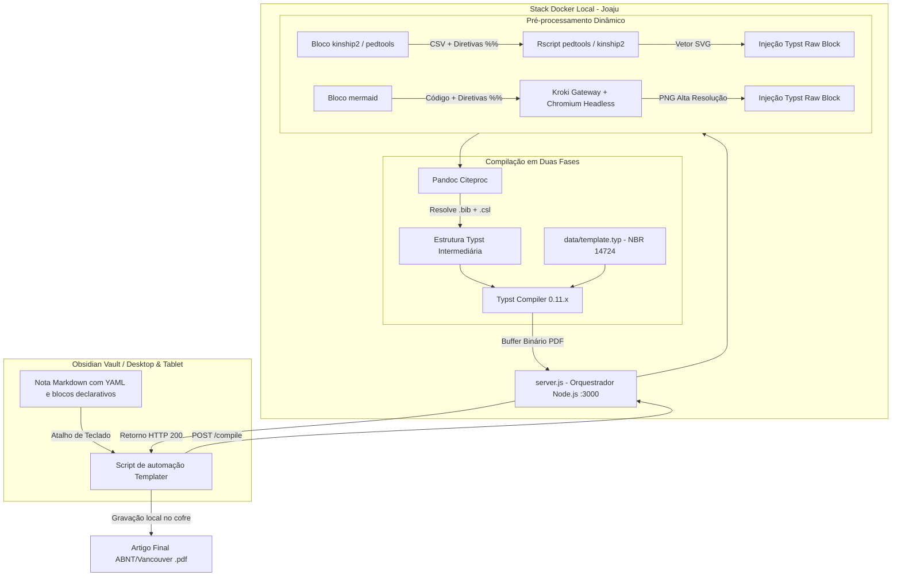

## 🗂️ Estrutura de Arquivos

Para subir o projeto, garanta a seguinte árvore de diretórios:

```text
joaju/
├── Dockerfile              # Imagem Node.js + Pandoc + R (kinship2) + Typst
├── docker-compose.yml      # Orquestração do compilador e dos serviços Kroki
├── server.js               # Orquestrador HTTP, regex e despacho dinâmico
├── plot_pedigree.R         # Motor R para geração de heredogramas clínicos
├── README.md               # Esta documentação
└── data/                   # Volume persistente montado no container
    ├── template.typ        # Regras tipográficas ABNT (NBR 14724)
    ├── abnt.csl            # Folha de estilo de citação ABNT (NBR 10520)
    ├── vancouver.csl        # Folha de estilo de citação Vancouver (Medicina)
    └── referencias.bib     # Arquivo exportado pelo Better BibTeX (Zotero)
```

## 🚀 Instalação e Execução

### 1. Pré-requisitos

* [Docker](https://docs.docker.com/get-docker/?utm_source=gemini) e Docker Compose instalados;
* [Obsidian](https://obsidian.md/?utm_source=gemini) com os plugins comunitários **Templater** e suporte a Mermaid ativo.

### 2. Download dos Estilos CSL

Dentro da pasta raiz do projeto, crie a pasta `data/` e baixe os estilos padronizados:

```bash
mkdir -p data

# Baixar estilo oficial ABNT
curl -fsSL "https://raw.githubusercontent.com/citation-style-language/styles/master/associacao-brasileira-de-normas-tecnicas.csl" -o data/abnt.csl

# Baixar estilo oficial Vancouver
curl -fsSL "https://raw.githubusercontent.com/citation-style-language/styles/master/vancouver.csl" -o data/vancouver.csl
```

### 3. Inicialização dos Containers

Execute o build e suba os serviços em segundo plano:

```bash
docker compose up -d --build
```

O orquestrador estará ativo em `http://localhost:3000`.

## ✍️ Guia de Uso no Obsidian
 
### 1. Frontmatter (YAML) e Perfis Tipográficos Suportados
 
O Joaju oferece suporte a três perfis tipográficos oficiais configuráveis no cabeçalho YAML da nota:
 
```yaml
---
titulo: Elaboração de Heredograma Familiar e Análise Genético-Clínica
subtitulo: Estudo de Caso Ambulatorial e Herança Autossômica Recessiva
autor: Equipe de Genética Médica
instituicao: Universidade Federal de Santa Catarina
local: Florianópolis
ano: 2026
perfil: trabalho-ufsc # Opções: 'trabalho-ufsc', 'abnt' ou 'vancouver'
---
```
 
#### 📚 Comparativo de Perfis de Compilação
 
| Perfil (`perfil:`) | Finalidade e Descrição | Regras Tipográficas / Template | Citação / CSL | Variáveis Suportadas no YAML |
|---|---|---|---|---|
| **`trabalho-ufsc`** | Trabalhos acadêmicos, relatórios e monografias da UFSC | Capa institucional automática, folha de rosto, margens 3cm/2cm, paginação a partir da folha 2 | `trabalho-ufsc.csl` (ABNT/UFSC) | `titulo`, `subtitulo`, `autor`, `instituicao`, `local`, `ano`, `fonte`, `tamanho` |
| **`abnt`** | Artigos científicos gerais em conformidade com ABNT NBR 14724 | Margens ABNT (sup./esq.: 3cm, inf./dir.: 2cm), espaçamento 1.5, numeração NBR 6024 | `abnt.csl` (Associação Brasileira de Normas Técnicas) | `titulo`, `autor`, `subtitulo`, `fonte`, `tamanho` |
| **`vancouver`** | Artigos e relatórios na área biomédica e da saúde | Estilo numérico internacional biomédico, referências ordenadas por citação no texto | `vancouver.csl` (ICMJE / NLM) | `titulo`, `autor`, `subtitulo`, `fonte`, `tamanho` |
 
#### ⚙️ Dicionário de Variáveis do YAML
 
* **`perfil`**: Identificador do perfil (`trabalho-ufsc`, `abnt` ou `vancouver`). Padrão: `abnt`.
* **`titulo`**: Título principal da publicação ou trabalho acadêmico.
* **`subtitulo`**: Subtítulo opcional (renderizado após dois-pontos ou abaixo do título conforme o perfil).
* **`autor`**: Nome do autor, discente ou autores do documento.
* **`instituicao`**: (Específico de `trabalho-ufsc`) Nome da universidade, centro e curso para a capa padronizada.
* **`local`**: (Específico de `trabalho-ufsc`) Cidade da instituição (ex.: `Florianópolis`).
* **`ano`**: (Específico de `trabalho-ufsc`) Ano da entrega acadêmica (ex.: `2026`).
* **`fonte`**: Família tipográfica do documento Typst (padrão: `Liberation Sans`).
* **`tamanho`**: Tamanho do corpo de texto principal (padrão: `12pt`).
 
---
 
### 2. Catálogo de Motores & Módulos Suportados
 
O Joaju inclui motores especializados para diagramação científica, heredogramas clínicos, química estrutural e tabelas acadêmicas. A documentação completa de cada motor com exemplos está disponível no site [joaju.2lp.in](https://joaju.2lp.in/#motores) e no cofre do Obsidian (`00_meta/joaju/`).
 
| Motor | Finalidade | Diretivas Joaju (`%%`) | Parâmetros do Motor Nativo / R | Documentação Completa |
|---|---|---|---|---|
| **`pedtools`** | **Principal:** Heredogramas clínicos modernos (pedsuite R) | `layout.width`, `layout.max_width`, `src`/`file` | `cex`, `symbolsize`, `foldLabs`, `margins`, `addSpace`, `col`, `lwd`, `lty`, `fill`, `plot_width`, `plot_height`, `legend`, `legend.type` | [pedtools.html](https://joaju.2lp.in/motores/pedtools.html) |
| **`kinship2`** | **Legado:** Heredogramas clínicos em phase-out | `layout.width`, `layout.max_width`, `src`/`file` | `cex`, `symbolsize`, `branch`, `density`, `angle`, `col`, `lwd`, `lty`, `plot_width`, `plot_height`, `legend`, `legend.type` | [kinship2.html](https://joaju.2lp.in/motores/kinship2.html) |
| **`table`** | Tabelas acadêmicas ABNT NBR 14724 e APA | `caption`/`title`, `note`/`fonte`, `align`, `columns`, `layout.width`, `src`/`file` | - | [table.html](https://joaju.2lp.in/motores/table.html) |
| **`openchemlib`** | Química estrutural 2D via SMILES | `title`, `layout.width`, `layout.max_width`, `width`, `height`, `file`/`src` | - | [quimica.html](https://joaju.2lp.in/motores/quimica.html) |
| **`openbabel`** | Química estrutural 2D via MOL/SDF | `title`, `layout.width`, `layout.max_width`, `file`/`src` | - | [quimica.html](https://joaju.2lp.in/motores/quimica.html) |
| **`mermaid`** | Fluxogramas, sequências, Gantt via Kroki | `layout.width`, `layout.max_width`, `src`/`file` | - | [mermaid.html](https://joaju.2lp.in/motores/mermaid.html) |
| **`d2`** | Diagramação declarativa moderna de sistemas | `layout.width`, `layout.max_width`, `src`/`file` | - | [d2.html](https://joaju.2lp.in/motores/d2.html) |
| **`plantuml`** | Diagramas UML e engenharia de software | `layout.width`, `layout.max_width`, `src`/`file` | - | [plantuml.html](https://joaju.2lp.in/motores/plantuml.html) |
| **`graphviz`** | Grafos e redes em linguagem DOT | `layout.width`, `layout.max_width`, `src`/`file` | - | [graphviz.html](https://joaju.2lp.in/motores/graphviz.html) |
| **`gist`** | Inclusão de scripts analíticos externos | `url`, `file`, `title` | - | [gist.html](https://joaju.2lp.in/motores/gist.html) |

---

### 3. Detalhamento dos Motores e Exemplos Práticos

#### 3.1. Heredogramas Clínicos (`pedtools` - Recomendado)

O motor `pedtools` padroniza árvores genealógicas com auto-dimensionamento vertical proporcional às gerações, divisão perfeita de heterozigotos (*half-fill*), marcação de probanda com respiro e legendas integradas.

```pedtools
%% layout.width=95% layout.max_width=720pt cex=0.85 symbolsize=1.25 legend=c("Normal (M)","Normal (F)","Afetado (M)","Afetada (F)","Probanda") legend.type=c("sq_empty","circ_empty","sq_solid","circ_solid","proband")
id,pai,mae,sex,fenotipo,proband,label
1,0,0,M,wt,0,I-1 [Normal]
2,0,0,F,afetado,0,I-2 [Afetada]
3,1,2,M,het,0,II-1 [Portador]
4,1,2,F,afetado,1,II-2 [Afetada]
5,1,2,M,wt,0,II-3 [Normal]
```

**Resultado Pré-executado:**
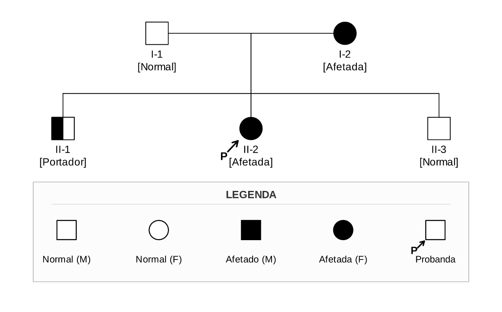

* **Colunas CSV**: `id`, `pai` (ou `fid`), `mae` (ou `mid`), `sex` (`M`/`F`/`1`/`2`), `fenotipo` (`wt`, `het`, `afetado`, `?`), `proband` (`1`/`0`), `label` (suporta `\n` via colchetes), `status` (`1`/`falecido`).
* **Tipos de Legenda**: `sq_empty`, `circ_empty`, `sq_half`, `circ_half`, `sq_solid`, `circ_solid`, `suspect`, `proband`.

#### 3.2. Heredogramas Legado (`kinship2` - Phase-out)

Permanece no Joaju para compatibilidade com notas antigas:

```kinship2
%% layout.width=90% layout.max_width=600pt cex=0.88 symbolsize=2.85 legend=c("Normal (M)","Portadora (F)","Afetado (M)","Probanda") legend.type=c("sq_empty","circ_half","sq_solid","proband")
id,pai,mae,sex,fenotipo,proband,label
1,0,0,M,wt,0,I.1
2,0,0,F,het,0,I.2
3,1,2,M,afetado,1,II.1 [Afetado]
4,1,2,F,wt,0,II.2 [Normal]
```

**Resultado Pré-executado:**
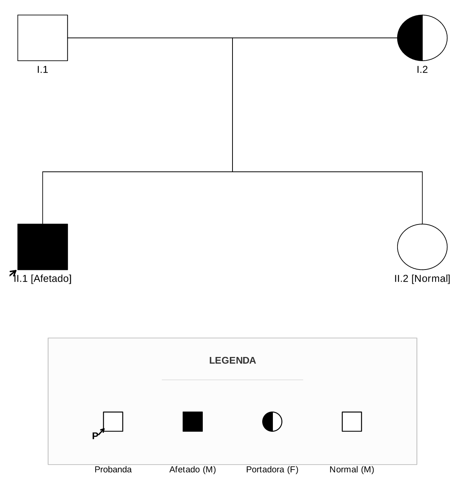

#### 3.3. Tabelas Acadêmicas (`table`)

Transforma dados CSV em tabelas tipográficas conforme ABNT NBR 14724 e APA:

```table
%% caption="Segregação Fenotípica e Genotípica na Geração F2 de Ervilhas (Pisum sativum)"
%% align=l, c, c, r
%% note="Fonte: Gregor Mendel, Versuche über Pflanzen-Hybriden (1866)."
Fenótipo Observado, Genótipo Provável, Contagem (N), Proporção Observada
Sementes Lisas (Dominante), $R R$ / $R r$, 5474, 74.74% (aprox. 3/4)
Sementes Rugosas (Recessivo), $r r$, 1850, 25.26% (aprox. 1/4)
Total Consolidado, -, 7324, 100.00% (3 : 1)
```

**Resultado Pré-executado:**
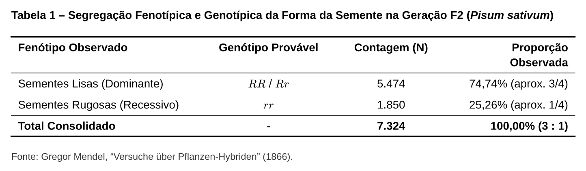

#### 3.4. Química Estrutural 2D (`openchemlib` e `openbabel`)

Renderização vetorial SVG de estruturas químicas a partir de notação SMILES ou arquivos MOL:

```openchemlib
%% layout.width=45% layout.max_width=300pt
%% title="Estrutura do 17β-Estradiol (Hormônio Estrogênio)"
%% layout.width=50% layout.max_width=350pt
C[C@]12CC[C@@H]3c4ccc(O)cc4CC[C@H]3[C@@H]1CC[C@@H]2O
```

**Resultado Pré-executado:**
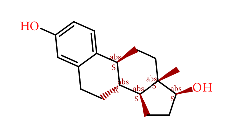

#### 3.5. Diagramas Técnicos (`d2`, `mermaid`, `plantuml`, `graphviz`)

##### Diagrama D2
```d2
%% width=75% max-width=500pt
coleta: Coleta de Sangue -> sequenciamento: Sequenciamento NGS
sequenciamento -> analise: Análise Bioinformática
analise -> laudo: Laudo Médico
```

**Resultado Pré-executado:**
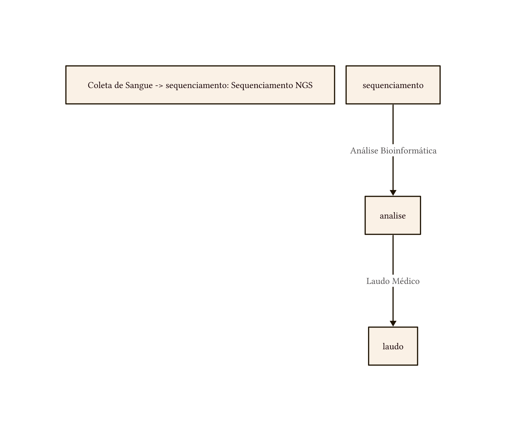

##### Diagrama Mermaid
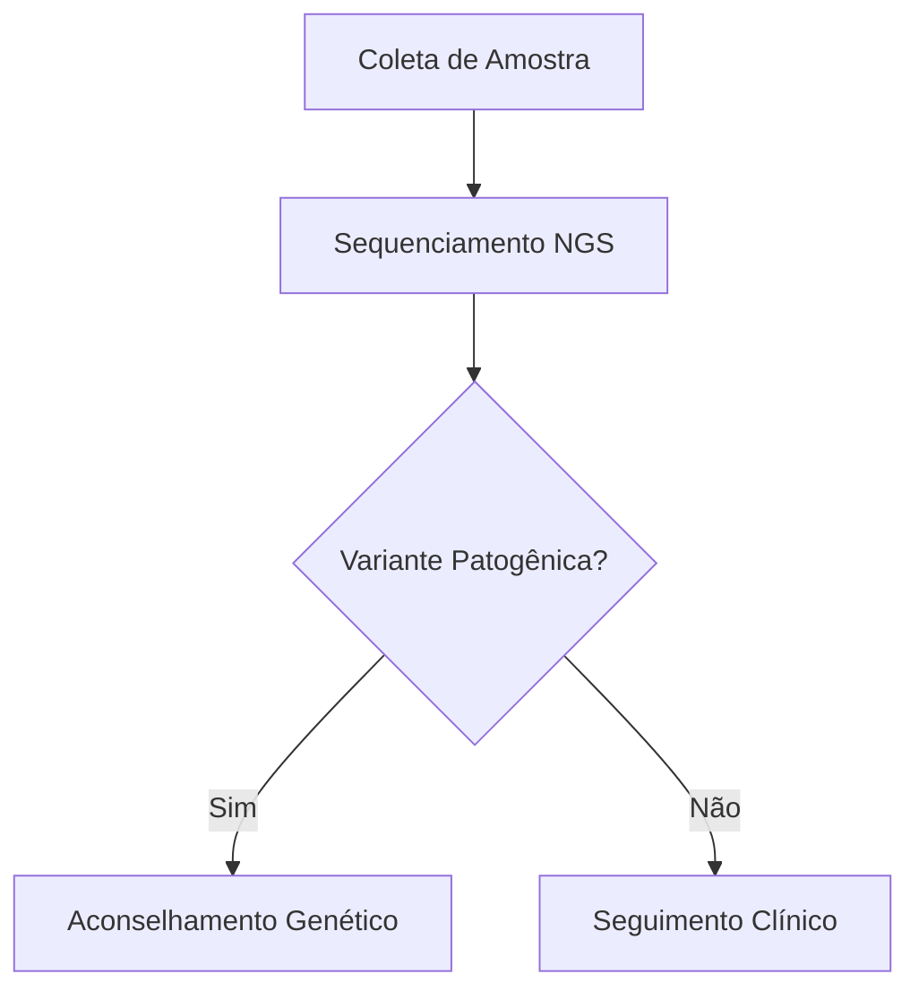

**Resultado Pré-executado:**
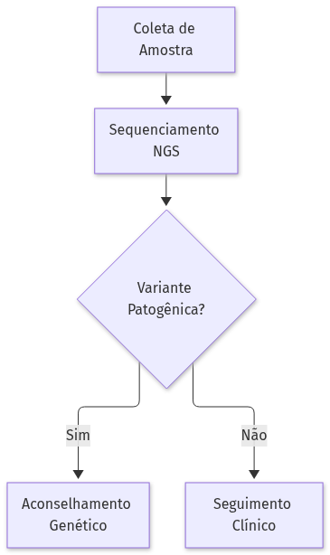

##### Diagrama PlantUML
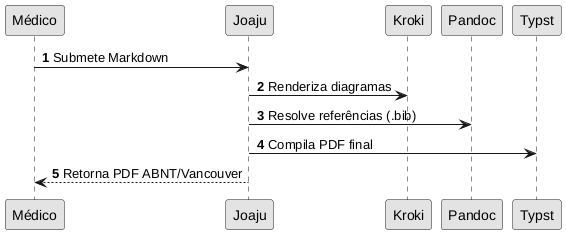

**Resultado Pré-executado:**
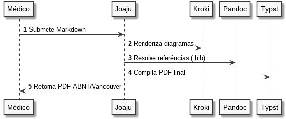

##### Grafo Graphviz DOT
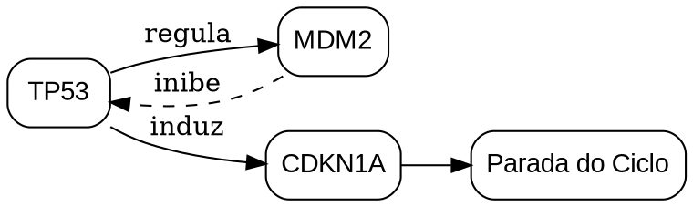

**Resultado Pré-executado:**
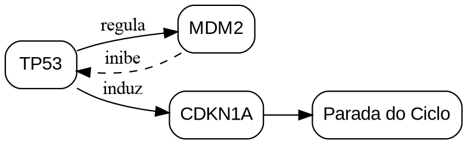

#### 3.6. Inclusão de Scripts Analíticos (`gist`)

Embutimento resiliente de scripts computacionais (R, Python, Julia, SQL) hospedados externamente:

```gist
%% url=https://gist.github.com/exemplo/calculo_frequencias
%% file=calculo_frequencias.R
%% title="Script R: Cálculo de Frequências Alélicas de Hardy-Weinberg"
```

**Resultado Pré-executado:**
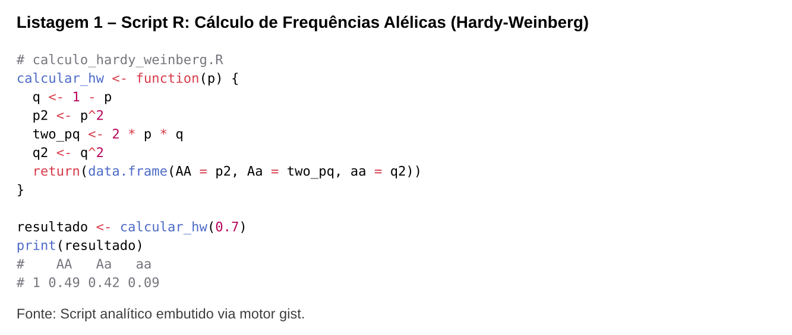

### 7. Integração via Templater no Obsidian

Para disparar a compilação via atalho de teclado:

1. Crie a nota `Compilar Artigo.md` dentro da sua pasta de templates do Obsidian com o código:

```javascript
<%*
const activeFile = app.workspace.getActiveFile();
if (!activeFile) {
    new Notice("❌ Nenhuma nota ativa para compilar!");
    return;
}

new Notice("⏳ Compilando via Joaju...");

try {
    const content = await app.vault.read(activeFile);

    const response = await fetch("http://localhost:3000/compile", {
        method: "POST",
        headers: { "Content-Type": "application/json" },
        body: JSON.stringify({ markdown: content })
    });

    if (!response.ok) {
        throw new Error(await response.text());
    }

    const buffer = await response.arrayBuffer();
    const folderPath = activeFile.parent ? activeFile.parent.path : "";
    const pdfPath = (folderPath && folderPath !== "/" ? folderPath + "/" : "") + activeFile.basename + ".pdf";

    const existingFile = app.vault.getAbstractFileByPath(pdfPath);
    if (existingFile) {
        await app.vault.modifyBinary(existingFile, buffer);
    } else {
        await app.vault.createBinary(pdfPath, buffer);
    }

    new Notice(`✅ PDF gerado: ${activeFile.basename}.pdf`);
} catch (err) {
    new Notice(`❌ Erro no Joaju: ${err.message}`, 10000);
}
_%>
```

1. Acesse **Configurações > Templater > Template Hotkeys**;

2. Associe `Compilar Artigo.md` ao atalho desejado (ex: `Ctrl + Alt + B`).

## 🛠️ API de Backend

### `GET /`

Interface web interativa (Playground) para edição e preview instantâneo de diagramas e heredogramas clínicos.

### `POST /render`

Renderiza instantaneamente um bloco de heredograma ou diagrama Mermaid isolado, devolvendo o gráfico em formato vetorial SVG.

* **Payload:**

  ```json
  {
    "code": "```kinship2\n%% layout.width=90%\nid,pai,mae,sex,fenotipo\n1,0,0,M,wt\n...\n```"
  }
  ```

* **Respostas:**

  * `200 OK`: JSON contendo o SVG gerado:
    ```json
    {
      "format": "kinship2",
      "type": "svg",
      "svg": "<svg ...>...</svg>"
    }
    ```

  * `400 Bad Request`: Parâmetros inválidos ou código vazio.

  * `500 Internal Server Error`: Erro no motor de renderização (Rscript ou Kroki).

### `POST /compile`

Recebe o conteúdo Markdown e compila para PDF acadêmico (Pandoc + Citeproc + Typst). Suporta duas modalidades de envio:

1. **Markdown em Texto Plano (JSON):**
   * **Content-Type:** `application/json`
   * **Payload:**
     ```json
     {
       "markdown": "# Conteúdo do artigo..."
     }
     ```

2. **Pacote de Workspace com Anexos (ZIP):**
   * **Content-Type:** `application/zip` (ou `application/octet-stream`)
   * **Payload:** Arquivo binário `.zip` contendo:
     * `main.md`: Artigo Markdown principal;
     * `attachments/`: Pasta contendo imagens referenciadas (`![[foto.png]]`, `![[imagem_com_underscore.png|500]]`, `![[foto.png|Legenda]]`), arquivos CSV (`%% src=...`) e arquivos químicos (`%% file=...`). O Joaju normaliza automaticamente wikilinks do Obsidian e imagens locais com caracteres especiais (`_`) para Typst nativo e formatação ABNT.
   * O Joaju descompacta o arquivo em um workspace efêmero `/tmp/job_<id>/`, permitindo que o Pandoc e o Typst acessem os arquivos diretamente por caminho relativo, eliminando a necessidade de converter dados pesados para Base64. O compilador Typst aplica saneamento automático de caracteres `<` isolados em textos e tabelas para prevenir falhas de `unclosed label`. O diretório temporário é excluído automaticamente logo após a compilação.

* **Respostas:**

  * `200 OK`: Binário `application/pdf` pronto para consumo.

  * `500 Internal Server Error`: Descrição detalhada dos erros emitidos pelo Pandoc, R ou Typst.

### `GET /health`

Sonda de integridade operacional (Health Check) para Docker, Kubernetes e scripts de orquestração CCCP.

* **Respostas:**
  * `200 OK`:
    ```json
    {
      "status": "ok",
      "name": "joaju",
      "version": "0.1.0",
      "uptime": 12.34
    }
    ```

### `POST /unfurl`

Extrai metadados ricos de uma URL (título, descrição, imagem de capa, domínio, autor, data, tempo de leitura estimado) usando **Readability** + **linkedom** — sem Chromium. Opcionalmente gera um snapshot PDF da página via Readability → Pandoc → Typst.

* **Payload:**

  ```json
  {
    "url": "https://example.com/artigo",
    "archive": false
  }
  ```

  | Campo | Tipo | Descrição |
  |---|---|---|
  | `url` | string | URL a ser desdobrada. Protocolos suportados: `http`, `https`. |
  | `archive` | boolean | Se `true`, inclui um snapshot PDF da página em `pdfBase64`. |

* **Respostas:**

  * `200 OK`:
    ```json
    {
      "ok": true,
      "url": "https://example.com/artigo",
      "title": "Título da Página",
      "description": "Resumo extraído do OG ou da meta description.",
      "imageUrl": "https://example.com/og-image.jpg",
      "faviconUrl": "https://example.com/favicon.ico",
      "domain": "example.com",
      "siteName": "Example",
      "author": "Autora Silva",
      "date": "2025-01-15",
      "readingTimeMin": 4,
      "hasArticle": true,
      "pdfBase64": "JVBERi0x..." 
    }
    ```
    > `pdfBase64` presente apenas quando `archive: true`.

  * `400 Bad Request`: `url` ausente ou vazio.
  * `422 Unprocessable Entity`: Protocolo não suportado ou servidor retornou erro HTTP.

## 🛠️ Interfaces de Desenvolvimento CCCP (Serve, Dev & Demo)

O Joaju implementa conformidade total com os comandos do ecossistema **CCCP**:

### 1. Servidor de Desenvolvimento com Recarga Contínua
```bash
# Via CCCP (delega automaticamente para scripts/dev.sh):
cccp serve --dev

# Com portas e opções customizadas:
./scripts/dev.sh --port 3100 --localhost --open

# Ou via npm:
npm run dev
```

### 2. Modo Demonstração VDNKh (Exposição de Conquistas)
```bash
# Executa rotina de validação e abre o Web Playground com fixtures semeadas em data/demo/:
cccp serve --demo

# Ou diretamente:
npm run demo
```

### 3. Servidor de Pré-visualização Estática
```bash
# Serve o Web Playground estático (./public) via Mayak ou Python:
cccp serve
```

## ⚖️ Conformidade GOST

Este repositório adota as diretrizes do padrão **GOST v1.0.0-draft** (perfil `lumen`). A integridade das especificações e regras de automação são gerenciadas via CLI `cccp` através do diretório `.gost/`.

## 📄 Licença

Projeto desenvolvido para automação acadêmica e clínica sob licença [Apache 2.0](https://www.apache.org/licenses/LICENSE-2.0).
