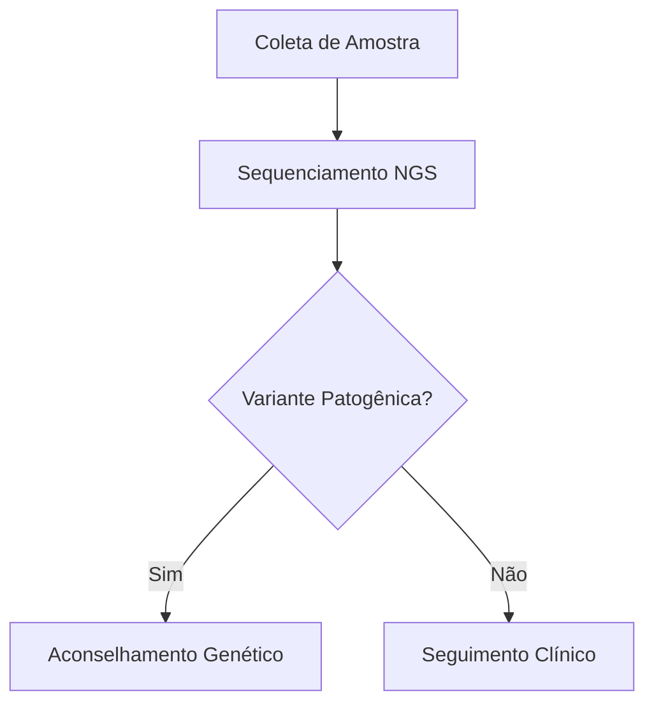

# Joaju (djo-a-DJÚ)

> **Joaju** (*Guarani*): Elo, união recíproca, conexão, aresta.
>
> Orquestrador declarativo local e compilador acadêmico com suporte a grafos, diagramas e heredogramas clínicos conforme a padronização internacional da NSGC.

## 📌 Visão Geral

O **Joaju** é um pipeline de diagramação e compilação acadêmica focado em privacidade, soberania de dados (aderência estrita à LGPD) e ergonomia no **Obsidian**. Ele atua como uma ponte entre anotações em Markdown e publicações biomédicas/técnicas no padrão ABNT ou Vancouver.

Em vez de sobrecarregar editores de texto com renderizadores pesados ou depender de serviços externos que violam o sigilo de prontuários, o Joaju encapsula uma stack de microsserviços via Docker que resolve:

1. **Heredogramas Clínicos Padronizados:** Processamento determinístico de árvores genealógicas via script R nativo (`kinship2`), convertendo tabelas simples em SVGs conformes às diretrizes da *National Society of Genetic Counselors* (NSGC) e da *American College of Medical Genetics* (ACMG).

2. **Diagramas Multimotor Isolados:** Renderização de fluxogramas e grafos (Mermaid e Graphviz) através de container local do Kroki, com controle de escala sem injeção de HTML no editor.

3. **Compilação Tipográfica Híbrida:** Uso do Pandoc (`--citeproc`) para resolução bibliográfica robusta integrada ao Zotero, compilando a saída estruturada em alta velocidade com o **Typst**.

## 🏗️ Arquitetura do Pipeline

```mermaid
flowchart TD
    subgraph Obsidian [Obsidian Vault / Desktop & Tablet]
        MD[Nota Markdown com YAML e blocos declarativos]
        TP[Script de automação Templater]
        MD -->|Atalho de Teclado| TP
    end

    subgraph Docker [Stack Docker Local - Joaju]
        direction TB
        SRV[server.js - Orquestrador Node.js :3000]
        TP -->|POST /compile| SRV

        subgraph Preprocess [Pré-processamento Dinâmico]
            direction LR
            H_BLK["```heredograma"] -->|CSV + Diretivas %%| R_ENG[Rscript plot_pedigree.R]
            M_BLK["```mermaid"] -->|Código + Diretivas %%| KRK[Kroki Gateway + Chromium Headless]
            R_ENG -->|Vetor SVG| TYP_INJ1[Injeção Typst Raw Block]
            KRK -->|PNG Alta Resolução| TYP_INJ2[Injeção Typst Raw Block]
        end

        SRV --> Preprocess

        subgraph Compilers [Compilação em Duas Fases]
            PANDOC[Pandoc Citeproc] -->|Resolve .bib + .csl| TYP_AST[Estrutura Typst Intermediária]
            TYP_AST --> TYPST[Typst Compiler 0.11.x]
            TEMPLATE[data/template.typ - NBR 14724] --> TYPST
        end

        Preprocess --> PANDOC
        TYPST -->|Buffer Binário PDF| SRV
    end

    SRV -->|Retorno HTTP 200| TP
    TP -->|Gravação local no cofre| PDF[Artigo Final ABNT/Vancouver .pdf]
```

## 🗂️ Estrutura de Arquivos

Para subir o projeto, garanta a seguinte árvore de diretórios:

```text
joaju/
├── Dockerfile              # Imagem Node.js + Pandoc + R (kinship2) + Typst
├── docker-compose.yml      # Orquestração do compilador e dos serviços Kroki
├── server.js               # Orquestrador HTTP, regex e despacho dinâmico
├── plot_pedigree.R         # Motor R para geração de heredogramas clínicos
├── README.md               # Esta documentação
└── data/                   # Volume persistente montado no container
    ├── template.typ        # Regras tipográficas ABNT (NBR 14724)
    ├── abnt.csl            # Folha de estilo de citação ABNT (NBR 10520)
    ├── vancouver.csl        # Folha de estilo de citação Vancouver (Medicina)
    └── referencias.bib     # Arquivo exportado pelo Better BibTeX (Zotero)
```

## 🚀 Instalação e Execução

### 1. Pré-requisitos

* [Docker](https://docs.docker.com/get-docker/?utm_source=gemini) e Docker Compose instalados;
* [Obsidian](https://obsidian.md/?utm_source=gemini) com os plugins comunitários **Templater** e suporte a Mermaid ativo.

### 2. Download dos Estilos CSL

Dentro da pasta raiz do projeto, crie a pasta `data/` e baixe os estilos padronizados:

```bash
mkdir -p data

# Baixar estilo oficial ABNT
curl -fsSL "https://raw.githubusercontent.com/citation-style-language/styles/master/associacao-brasileira-de-normas-tecnicas.csl" -o data/abnt.csl

# Baixar estilo oficial Vancouver
curl -fsSL "https://raw.githubusercontent.com/citation-style-language/styles/master/vancouver.csl" -o data/vancouver.csl
```

### 3. Inicialização dos Containers

Execute o build e suba os serviços em segundo plano:

```bash
docker compose up -d --build
```

O orquestrador estará ativo em `http://localhost:3000`.

## ✍️ Guia de Uso no Obsidian

### 1. Frontmatter (YAML)

Defina o padrão de citação no cabeçalho da nota. O Joaju selecionará o arquivo `.csl` correspondente em `/data`:

```yaml
---
titulo: Análise Genético-Clínica da Linhagem Familiar
autor: Dra. Lumen
perfil: vancouver # Opções: 'vancouver' ou 'abnt'
---
```

### 2. Heredogramas Clínicos (\`\`\`\`heredograma\`)

O Joaju interpreta tabelas com cabeçalhos amigáveis em português ou parâmetros canônicos do `kinship2`. As diretivas de tamanho e ajustes do motor são passadas na linha com `%%`.

#### Exemplo Completo (Fibrose Cística com Portadores e Gêmeos MZ)

````markdown
### Análise Genealógica da Linhagem

```heredograma
%% layout.width=85% layout.max_width=520pt
%% cex=0.85 symbolsize=1.0 branch=0.5 packed=TRUE align=c(1.5,2)
id,   pai,  mae,  sexo, fenotipo, falecido, probando, idade, genotipo,      gemeo_com, tipo_gemeo, label
I:1,    0,    0,     M, portador,        0,        0,   68a, wt/c.1521,             0,          0, I:1
I:2,    0,    0,     F, portador,        0,        0,   65a, wt/c.1521,             0,          0, I:2
II:1, I:1,  I:2,     M,  afetado,        1,        0,  †12a, c.1521/1521,           0,          0, II:1
II:2, I:1,  I:2,     F, portador,        0,        1,   38a, wt/c.1521,          II:3,         MZ, II:2 [P]
II:3, I:1,  I:2,     F, portador,        0,        0,   38a, wt/c.1521,          II:2,         MZ, II:3
II:4,   0,    0,     M,   higido,        0,        0,   41a, wt/wt,                 0,          0, II:4
III:1,II:4, II:2,    F,   higido,        0,        0,    8a, wt/wt,                 0,          0, III:1
III:2,II:4, II:2,    M,        ?,        0,        0,    6a, pendente,              0,          0, III:2
```
````

#### Dicionário de Colunas e Estados Clínicos

| **Campo** | **Valores Aceitos** | **Comportamento no Traçado** |
| :--- | :--- | :--- |
| `id` | Texto / Código (ex: `I:1`) | Identificador do sujeito na matriz de parentesco |
| `pai` / `mae` | ID ou `0` / vazio | Conexão parental (`0` cria nó fundador raiz) |
| `sexo` | `M`, `F`, `U` (ou `?`), `T` | `M` = Quadrado, `F` = Círculo, `U` = Losango, `T` = Aborto |
| `fenotipo` | `hom` / `afetado` / `1` | Símbolo **totalmente preenchido** (preto) |
| | `het` / `portador` | Símbolo **meio preenchido** (metade vertical esquerda) |
| | `higido` / `wt` / `0` | Símbolo **em branco** (contorno fino) |
| | `?` / `desconhecido` | Insere uma interrogação interna no símbolo |
| `falecido` | `1` ou `0` | Traça barra diagonal de óbito a 45° sobre o símbolo |
| `probando` | `1` ou `0` | Destaca o caso índice na árvore |
| `gemeo_com` | ID do irmão | Declara vínculo gemelar direto |
| `tipo_gemeo` | `MZ` ou `DZ` | `MZ` adiciona barra horizontal entre ramos; `DZ` ramifica em V |
| `label` | Texto customizado | Sobrescreve o texto impresso logo abaixo do símbolo |

### 3. Diagramas de Fluxo e Processo (```mermaid```)

Sem tags HTML na nota. O tamanho de exibição no PDF final é controlado por diretivas de comentário `%%`, garantindo que o **Live Preview do Obsidian continue funcionando**:

````markdown

````

### 4. Integração via Templater no Obsidian

Para disparar a compilação via atalho de teclado:

1. Crie a nota `Compilar Artigo.md` dentro da sua pasta de templates do Obsidian com o código:

```javascript
<%*
const activeFile = app.workspace.getActiveFile();
if (!activeFile) {
    new Notice("❌ Nenhuma nota ativa para compilar!");
    return;
}

new Notice("⏳ Compilando via Joaju...");

try {
    const content = await app.vault.read(activeFile);

    const response = await fetch("http://localhost:3000/compile", {
        method: "POST",
        headers: { "Content-Type": "application/json" },
        body: JSON.stringify({ markdown: content })
    });

    if (!response.ok) {
        throw new Error(await response.text());
    }

    const buffer = await response.arrayBuffer();
    const folderPath = activeFile.parent ? activeFile.parent.path : "";
    const pdfPath = (folderPath && folderPath !== "/" ? folderPath + "/" : "") + activeFile.basename + ".pdf";

    const existingFile = app.vault.getAbstractFileByPath(pdfPath);
    if (existingFile) {
        await app.vault.modifyBinary(existingFile, buffer);
    } else {
        await app.vault.createBinary(pdfPath, buffer);
    }

    new Notice(`✅ PDF gerado: ${activeFile.basename}.pdf`);
} catch (err) {
    new Notice(`❌ Erro no Joaju: ${err.message}`, 10000);
}
_%>
```

1. Acesse **Configurações > Templater > Template Hotkeys**;

2. Associe `Compilar Artigo.md` ao atalho desejado (ex: `Ctrl + Alt + B`).

## 🛠️ API de Backend

### `POST /compile`

Recebe o conteúdo Markdown bruto e entrega o PDF diagramado.

* **Payload:**

  ```json
  {
    "markdown": "# Conteúdo do artigo..."
  }
  ```

* **Respostas:**

  * `200 OK`: Binário `application/pdf` pronto para consumo.

  * `500 Internal Server Error`: Descrição detalhada dos erros emitidos pelo Pandoc, R ou Typst.

## ⚖️ Conformidade GOST

Este repositório adota as diretrizes do padrão **GOST v1.0.0-draft** (perfil `lumen`). A integridade das especificações e regras de automação são gerenciadas via CLI `cccp` através do diretório `.gost/`.

## 📄 Licença

Projeto desenvolvido para automação acadêmica e clínica sob licença [Apache 2.0](https://www.apache.org/licenses/LICENSE-2.0).
