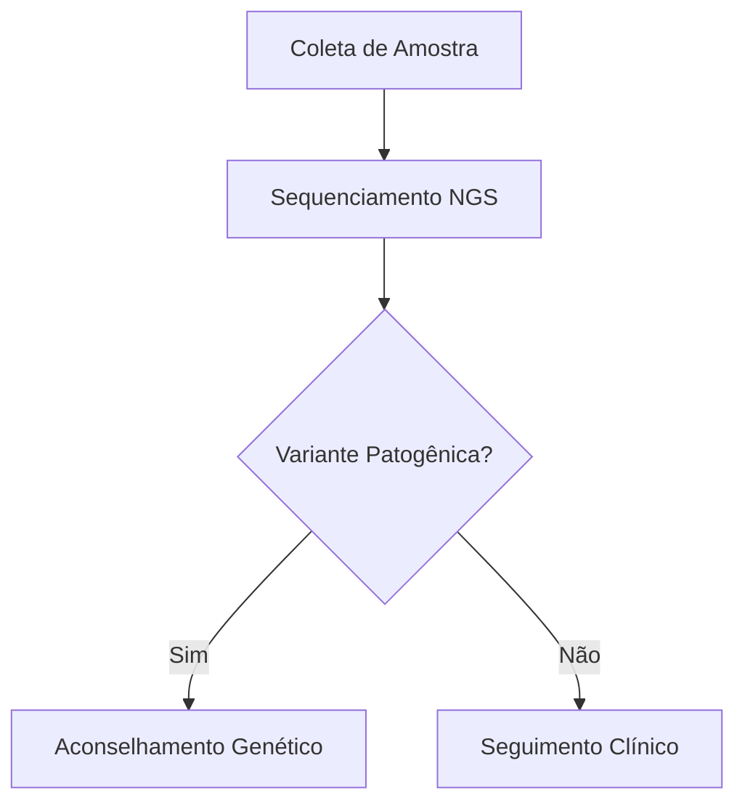

# Joaju (djo-a-DJÚ)

> **Joaju** (*Guarani*): Elo, união recíproca, conexão, aresta.
>
> Orquestrador declarativo local e compilador acadêmico para produção de diagramas e gráficos científicos, com extensão para heredogramas clínicos.

## 📌 Visão Geral

O **Joaju** é um pipeline de diagramação e compilação acadêmica focado em privacidade, soberania de dados (aderência estrita à LGPD) e ergonomia no **Obsidian**. Ele atua como uma ponte entre anotações em Markdown e publicações acadêmicas/técnicas no padrão ABNT ou Vancouver.

Em vez de sobrecarregar editores de texto com renderizadores pesados ou depender de serviços externos que violam o sigilo de dados, o Joaju encapsula uma stack de microsserviços via Docker que resolve:

1. **Diagramas Multimotor & Gráficos Científicos:** Renderização de fluxogramas, arquiteturas e grafos (Mermaid, Graphviz, PlantUML) através de integração transparente com o Kroki, com controle de escala sem injeção de HTML no editor.

2. **Compilação Tipográfica Híbrida:** Uso do Pandoc (`--citeproc`) para resolução bibliográfica robusta integrada ao Zotero, compilando a saída estruturada em alta velocidade com o **Typst** e templates ABNT NBR 14724.

3. **Módulo Especializado de Heredogramas:** Processamento determinístico de árvores genealógicas clínicas via script R nativo (`kinship2`), convertendo tabelas simples em SVGs conformes às diretrizes da *National Society of Genetic Counselors* (NSGC) e da *American College of Medical Genetics* (ACMG).

## 🏗️ Arquitetura do Pipeline

```mermaid
flowchart TD
    subgraph Obsidian [Obsidian Vault / Desktop & Tablet]
        MD[Nota Markdown com YAML e blocos declarativos]
        TP[Script de automação Templater]
        MD -->|Atalho de Teclado| TP
    end

    subgraph Docker [Stack Docker Local - Joaju]
        direction TB
        SRV[server.js - Orquestrador Node.js :3000]
        TP -->|POST /compile| SRV

        subgraph Preprocess [Pré-processamento Dinâmico]
            direction LR
            H_BLK["```kinship2 / ```pedtools"] -->|CSV + Diretivas %%| R_ENG[Rscript pedtools / kinship2]
            M_BLK["```mermaid"] -->|Código + Diretivas %%| KRK[Kroki Gateway + Chromium Headless]
            R_ENG -->|Vetor SVG| TYP_INJ1[Injeção Typst Raw Block]
            KRK -->|PNG Alta Resolução| TYP_INJ2[Injeção Typst Raw Block]
        end

        SRV --> Preprocess

        subgraph Compilers [Compilação em Duas Fases]
            PANDOC[Pandoc Citeproc] -->|Resolve .bib + .csl| TYP_AST[Estrutura Typst Intermediária]
            TYP_AST --> TYPST[Typst Compiler 0.11.x]
            TEMPLATE[data/template.typ - NBR 14724] --> TYPST
        end

        Preprocess --> PANDOC
        TYPST -->|Buffer Binário PDF| SRV
    end

    SRV -->|Retorno HTTP 200| TP
    TP -->|Gravação local no cofre| PDF[Artigo Final ABNT/Vancouver .pdf]
```

## 🗂️ Estrutura de Arquivos

Para subir o projeto, garanta a seguinte árvore de diretórios:

```text
joaju/
├── Dockerfile              # Imagem Node.js + Pandoc + R (kinship2) + Typst
├── docker-compose.yml      # Orquestração do compilador e dos serviços Kroki
├── server.js               # Orquestrador HTTP, regex e despacho dinâmico
├── plot_pedigree.R         # Motor R para geração de heredogramas clínicos
├── README.md               # Esta documentação
└── data/                   # Volume persistente montado no container
    ├── template.typ        # Regras tipográficas ABNT (NBR 14724)
    ├── abnt.csl            # Folha de estilo de citação ABNT (NBR 10520)
    ├── vancouver.csl        # Folha de estilo de citação Vancouver (Medicina)
    └── referencias.bib     # Arquivo exportado pelo Better BibTeX (Zotero)
```

## 🚀 Instalação e Execução

### 1. Pré-requisitos

* [Docker](https://docs.docker.com/get-docker/?utm_source=gemini) e Docker Compose instalados;
* [Obsidian](https://obsidian.md/?utm_source=gemini) com os plugins comunitários **Templater** e suporte a Mermaid ativo.

### 2. Download dos Estilos CSL

Dentro da pasta raiz do projeto, crie a pasta `data/` e baixe os estilos padronizados:

```bash
mkdir -p data

# Baixar estilo oficial ABNT
curl -fsSL "https://raw.githubusercontent.com/citation-style-language/styles/master/associacao-brasileira-de-normas-tecnicas.csl" -o data/abnt.csl

# Baixar estilo oficial Vancouver
curl -fsSL "https://raw.githubusercontent.com/citation-style-language/styles/master/vancouver.csl" -o data/vancouver.csl
```

### 3. Inicialização dos Containers

Execute o build e suba os serviços em segundo plano:

```bash
docker compose up -d --build
```

O orquestrador estará ativo em `http://localhost:3000`.

## ✍️ Guia de Uso no Obsidian

### 1. Frontmatter (YAML)

Defina o padrão de citação no cabeçalho da nota. O Joaju selecionará o arquivo `.csl` correspondente em `/data`:

```yaml
---
titulo: Análise Genético-Clínica da Linhagem Familiar
autor: Dra. Lumen
perfil: vancouver # Opções: 'vancouver' ou 'abnt'
---
```

### 2. Heredogramas Clínicos (`pedtools` e `kinship2`)

O Joaju oferece suporte a dois motores especializados em genética clínica:

* **`pedtools` (Recomendado):** Padrão moderno do ecossistema pedsuite em R, com suporte robusto a fundadores múltiplos, casamentos consanguíneos e formatação padronizada.
* **`kinship2`:** Motor de heredogramas clínicos baseado no pacote `kinship2` em R.

#### Exemplo Completo com `pedtools`

````markdown
### Análise Genealógica da Linhagem

```pedtools
%% layout.width=85% layout.max_width=520pt
%% title="Linhagem Familiar - Fibrose Cística"
id,   fid,  mid,  sex, aff
I:1,    0,    0,    1,   1
I:2,    0,    0,    2,   1
II:1, I:1,  I:2,    1,   2
II:2, I:1,  I:2,    2,   1
```
````

#### Importação de Dados Externos (`%% src=` ou `%% file=`)

Você pode separar os dados genealógicos do arquivo Markdown, referenciando arquivos locais anexos ou URLs remotas:

````markdown
```pedtools
%% src=attachments/familia_silva.csv
%% layout.width=80%
```
````

### 3. Química Estrutural 2D (`openchemlib` e `openbabel`)

Renderize estruturas moleculares 2D em SVG vetorial de alta resolução a partir de notação SMILES, fórmulas ou arquivos MOL/SDF:

````markdown
```openchemlib
%% title="Molécula de Ácido Acetilsalicílico (Aspirina)"
CC(=O)Oc1ccccc1C(=O)O
```
````

Também suporta referência a arquivos de moléculas na pasta de anexos:

````markdown
```openchemlib
%% file=attachments/cafeina.mol
```
````

### 4. Tabelas Acadêmicas (`table`)

Transforma arquivos CSV ou dados tabulares em tabelas com tipografia acadêmica estrita (estilo APA/ABNT com réguas horizontais superior, intermediária e inferior, e alinhamento numérico):

````markdown
```table
%% caption="Resultados dos Grupos de Teste Clínico"
%% src=attachments/tabela_resultados.csv
```
````

### 5. Diagramas Técnicos (`d2`, `plantuml`, `graphviz`, `mermaid`)

Suporte completo a diagramas arquiteturais e de fluxo sem injeção de HTML no editor:

````markdown
```d2
%% width=75%
coleta: Coleta de Sangue -> sequenciamento: Sequenciamento NGS
sequenciamento -> analise: Análise Bioinformática
analise -> laudo: Laudo Médico
```
````

````markdown

````

### 4. Integração via Templater no Obsidian

Para disparar a compilação via atalho de teclado:

1. Crie a nota `Compilar Artigo.md` dentro da sua pasta de templates do Obsidian com o código:

```javascript
<%*
const activeFile = app.workspace.getActiveFile();
if (!activeFile) {
    new Notice("❌ Nenhuma nota ativa para compilar!");
    return;
}

new Notice("⏳ Compilando via Joaju...");

try {
    const content = await app.vault.read(activeFile);

    const response = await fetch("http://localhost:3000/compile", {
        method: "POST",
        headers: { "Content-Type": "application/json" },
        body: JSON.stringify({ markdown: content })
    });

    if (!response.ok) {
        throw new Error(await response.text());
    }

    const buffer = await response.arrayBuffer();
    const folderPath = activeFile.parent ? activeFile.parent.path : "";
    const pdfPath = (folderPath && folderPath !== "/" ? folderPath + "/" : "") + activeFile.basename + ".pdf";

    const existingFile = app.vault.getAbstractFileByPath(pdfPath);
    if (existingFile) {
        await app.vault.modifyBinary(existingFile, buffer);
    } else {
        await app.vault.createBinary(pdfPath, buffer);
    }

    new Notice(`✅ PDF gerado: ${activeFile.basename}.pdf`);
} catch (err) {
    new Notice(`❌ Erro no Joaju: ${err.message}`, 10000);
}
_%>
```

1. Acesse **Configurações > Templater > Template Hotkeys**;

2. Associe `Compilar Artigo.md` ao atalho desejado (ex: `Ctrl + Alt + B`).

## 🛠️ API de Backend

### `GET /`

Interface web interativa (Playground) para edição e preview instantâneo de diagramas e heredogramas clínicos.

### `POST /render`

Renderiza instantaneamente um bloco de heredograma ou diagrama Mermaid isolado, devolvendo o gráfico em formato vetorial SVG.

* **Payload:**

  ```json
  {
    "code": "```kinship2\n%% layout.width=90%\nid,pai,mae,sex,fenotipo\n1,0,0,M,wt\n...\n```"
  }
  ```

* **Respostas:**

  * `200 OK`: JSON contendo o SVG gerado:
    ```json
    {
      "format": "kinship2",
      "type": "svg",
      "svg": "<svg ...>...</svg>"
    }
    ```

  * `400 Bad Request`: Parâmetros inválidos ou código vazio.

  * `500 Internal Server Error`: Erro no motor de renderização (Rscript ou Kroki).

### `POST /compile`

Recebe o conteúdo Markdown e compila para PDF acadêmico (Pandoc + Citeproc + Typst). Suporta duas modalidades de envio:

1. **Markdown em Texto Plano (JSON):**
   * **Content-Type:** `application/json`
   * **Payload:**
     ```json
     {
       "markdown": "# Conteúdo do artigo..."
     }
     ```

2. **Pacote de Workspace com Anexos (ZIP):**
   * **Content-Type:** `application/zip` (ou `application/octet-stream`)
   * **Payload:** Arquivo binário `.zip` contendo:
     * `main.md`: Artigo Markdown principal;
     * `attachments/`: Pasta contendo imagens referenciadas (`![[foto.png]]`, `![[imagem_com_underscore.png|500]]`, `![[foto.png|Legenda]]`), arquivos CSV (`%% src=...`) e arquivos químicos (`%% file=...`). O Joaju normaliza automaticamente wikilinks do Obsidian e imagens locais com caracteres especiais (`_`) para Typst nativo e formatação ABNT.
   * O Joaju descompacta o arquivo em um workspace efêmero `/tmp/job_<id>/`, permitindo que o Pandoc e o Typst acessem os arquivos diretamente por caminho relativo, eliminando a necessidade de converter dados pesados para Base64. O compilador Typst aplica saneamento automático de caracteres `<` isolados em textos e tabelas para prevenir falhas de `unclosed label`. O diretório temporário é excluído automaticamente logo após a compilação.

* **Respostas:**

  * `200 OK`: Binário `application/pdf` pronto para consumo.

  * `500 Internal Server Error`: Descrição detalhada dos erros emitidos pelo Pandoc, R ou Typst.

### `GET /health`

Sonda de integridade operacional (Health Check) para Docker, Kubernetes e scripts de orquestração CCCP.

* **Respostas:**
  * `200 OK`:
    ```json
    {
      "status": "ok",
      "name": "joaju",
      "version": "0.1.0",
      "uptime": 12.34
    }
    ```

### `POST /unfurl`

Extrai metadados ricos de uma URL (título, descrição, imagem de capa, domínio, autor, data, tempo de leitura estimado) usando **Readability** + **linkedom** — sem Chromium. Opcionalmente gera um snapshot PDF da página via Readability → Pandoc → Typst.

* **Payload:**

  ```json
  {
    "url": "https://example.com/artigo",
    "archive": false
  }
  ```

  | Campo | Tipo | Descrição |
  |---|---|---|
  | `url` | string | URL a ser desdobrada. Protocolos suportados: `http`, `https`. |
  | `archive` | boolean | Se `true`, inclui um snapshot PDF da página em `pdfBase64`. |

* **Respostas:**

  * `200 OK`:
    ```json
    {
      "ok": true,
      "url": "https://example.com/artigo",
      "title": "Título da Página",
      "description": "Resumo extraído do OG ou da meta description.",
      "imageUrl": "https://example.com/og-image.jpg",
      "faviconUrl": "https://example.com/favicon.ico",
      "domain": "example.com",
      "siteName": "Example",
      "author": "Autora Silva",
      "date": "2025-01-15",
      "readingTimeMin": 4,
      "hasArticle": true,
      "pdfBase64": "JVBERi0x..." 
    }
    ```
    > `pdfBase64` presente apenas quando `archive: true`.

  * `400 Bad Request`: `url` ausente ou vazio.
  * `422 Unprocessable Entity`: Protocolo não suportado ou servidor retornou erro HTTP.

## 🛠️ Interfaces de Desenvolvimento CCCP (Serve, Dev & Demo)

O Joaju implementa conformidade total com os comandos do ecossistema **CCCP**:

### 1. Servidor de Desenvolvimento com Recarga Contínua
```bash
# Via CCCP (delega automaticamente para scripts/dev.sh):
cccp serve --dev

# Com portas e opções customizadas:
./scripts/dev.sh --port 3100 --localhost --open

# Ou via npm:
npm run dev
```

### 2. Modo Demonstração VDNKh (Exposição de Conquistas)
```bash
# Executa rotina de validação e abre o Web Playground com fixtures semeadas em data/demo/:
cccp serve --demo

# Ou diretamente:
npm run demo
```

### 3. Servidor de Pré-visualização Estática
```bash
# Serve o Web Playground estático (./public) via Mayak ou Python:
cccp serve
```

## ⚖️ Conformidade GOST

Este repositório adota as diretrizes do padrão **GOST v1.0.0-draft** (perfil `lumen`). A integridade das especificações e regras de automação são gerenciadas via CLI `cccp` através do diretório `.gost/`.

## 📄 Licença

Projeto desenvolvido para automação acadêmica e clínica sob licença [Apache 2.0](https://www.apache.org/licenses/LICENSE-2.0).
