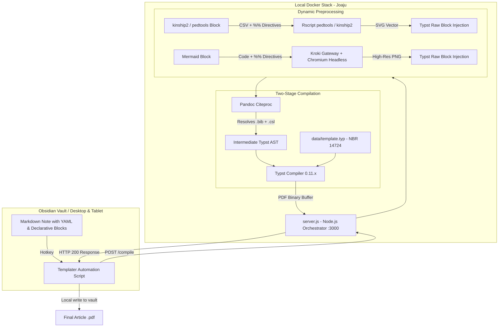
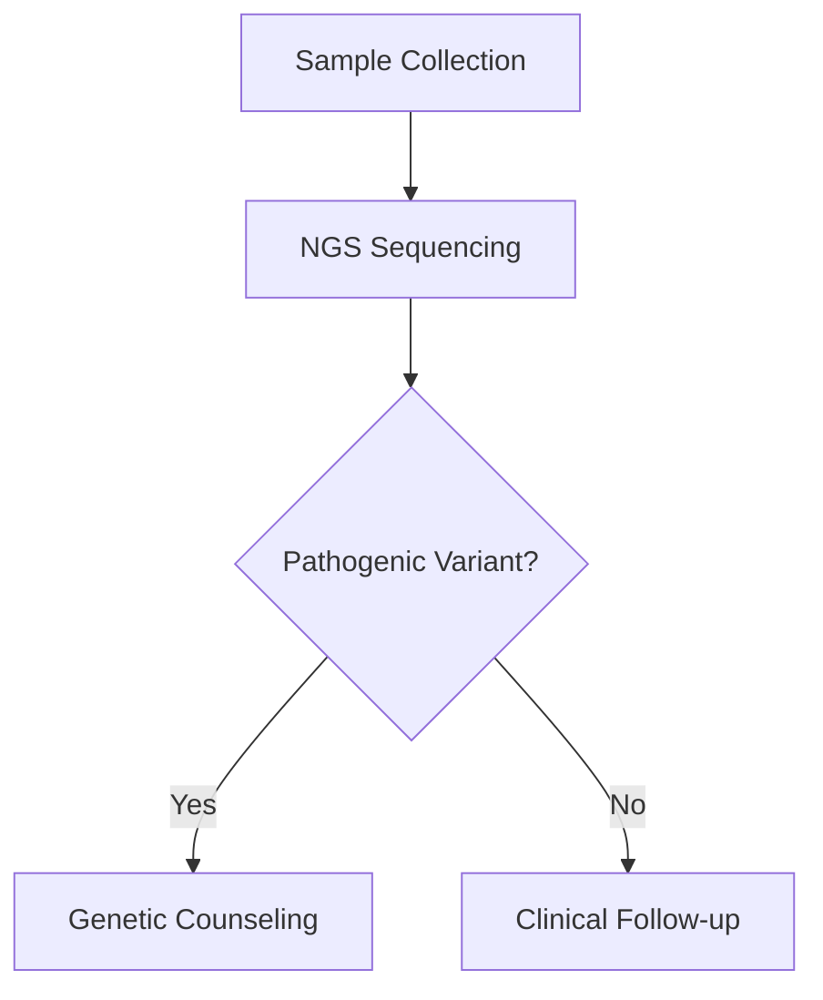
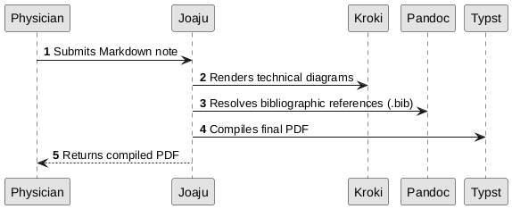
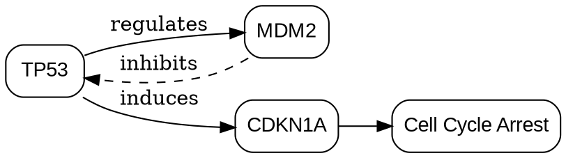

# Joaju (djo-a-DJÚ)

[](https://crates.io/crates/joaju)
[](https://docs.rs/joaju)
[](LICENSE)
[](https://codeberg.org/lumenpink/gost)

> **Joaju** (*Guarani*): Link, reciprocal bond, connection, edge.  
> Declarative local orchestrator and native scientific academic compiler in Rust for Typst typographical output, charts, academic tables, and clinical pedigrees.

> ⚠️ **Active Development Notice (pre-1.0 / dev)**  
> Joaju is currently in early active development (`0.2.x`). The API and HTTP endpoints are evolving prior to stabilizing version 1.0.0. Feedback and contributions are welcome!

## 📌 Overview

**Joaju** is an academic layout and compilation pipeline focused on privacy, deterministic execution, data protection compliance (strict LGPD alignment), and ergonomic integration with **Obsidian**. It acts as a bridge between Markdown notes and academic/technical publications compliant with standards such as ABNT or Vancouver.

Rather than overloading text editors with heavy renderers or relying on third-party cloud services that compromise data confidentiality, Joaju encapsulates a Docker-backed microservice stack that provides:

1. **Multi-Engine Diagrams & Scientific Graphics:** Rendering flowcharts, system architectures, and graphs (Mermaid, Graphviz, PlantUML) via seamless integration with Kroki, featuring layout scale control without injecting HTML into the editor.

2. **Hybrid Typographical Compilation:** Leveraging Pandoc (`--citeproc`) for robust bibliographic resolution integrated with Zotero, compiling structured output at high speed with **Typst** and academic templates (e.g., ABNT NBR 14724).

3. **Specialized Pedigree Module:** Deterministic processing of clinical pedigrees via native R engines (`kinship2` / `pedtools`), converting tabular records into standards-compliant SVGs aligned with the guidelines of the *National Society of Genetic Counselors* (NSGC) and the *American College of Medical Genetics* (ACMG).

## 🏗️ Pipeline Architecture



## 🗂️ File Structure

The project repository structure is organized as follows:

```text
joaju/
├── Dockerfile              # Container image: Node.js + Pandoc + R (kinship2/pedtools) + Typst
├── docker-compose.yml      # Service orchestration for compiler and Kroki gateway
├── server.js               # HTTP orchestrator, regex preprocessors, and dynamic dispatch
├── plot_pedigree.R         # R engine for clinical pedigree rendering
├── README.md               # Ecosystem documentation
└── data/                   # Persistent volume mounted in container
    ├── template.typ        # Typst typographical rules (NBR 14724)
    ├── abnt.csl            # ABNT citation style (NBR 10520)
    ├── vancouver.csl       # Vancouver citation style (Medical / ICMJE)
    └── referencias.bib     # References exported by Better BibTeX (Zotero)
```

## 🚀 Installation and Setup

### 1. Prerequisites

* [Docker](https://docs.docker.com/get-docker/?utm_source=gemini) and Docker Compose installed.
* [Obsidian](https://obsidian.md/?utm_source=gemini) with community plugins **Templater** and active Mermaid support.

### 2. Download CSL Styles

In the project root directory, ensure the `data/` directory exists and download the standardized styles:

```bash
mkdir -p data

# Download official ABNT citation style
curl -fsSL "https://raw.githubusercontent.com/citation-style-language/styles/master/associacao-brasileira-de-normas-tecnicas.csl" -o data/abnt.csl

# Download official Vancouver citation style
curl -fsSL "https://raw.githubusercontent.com/citation-style-language/styles/master/vancouver.csl" -o data/vancouver.csl
```

### 3. Launching Containers

Build and run the services in the background:

```bash
docker compose up -d --build
```

The orchestrator service will be available at `http://localhost:3000`.

## ✍️ Obsidian Usage Guide
 
### 1. Frontmatter (YAML) and Supported Typographical Profiles
 
Joaju supports three official typographical profiles configured in the note's YAML frontmatter:
 
```yaml
---
titulo: Family Pedigree Analysis and Clinical Genetics Study
subtitulo: Outpatient Case Report and Autosomal Recessive Inheritance
autor: Medical Genetics Team
instituicao: Federal University of Santa Catarina
local: Florianopolis
ano: 2026
perfil: trabalho-ufsc # Options: 'trabalho-ufsc', 'abnt', or 'vancouver'
---
```
 
#### 📚 Compilation Profiles Comparison
 
| Profile (`perfil:`) | Purpose & Description | Typographical Rules / Template | Citation / CSL | Supported YAML Variables |
|---|---|---|---|---|
| **`trabalho-ufsc`** | UFSC academic theses, reports, and monographs | Automated institutional cover, title page, 3cm/2cm margins, pagination from page 2 | `trabalho-ufsc.csl` (ABNT/UFSC) | `titulo`, `subtitulo`, `autor`, `instituicao`, `local`, `ano`, `fonte`, `tamanho` |
| **`abnt`** | General academic papers conforming to ABNT NBR 14724 | ABNT margins (top/left: 3cm, bottom/right: 2cm), 1.5 line spacing, NBR 6024 numbering | `abnt.csl` (Brazilian National Standards) | `titulo`, `autor`, `subtitulo`, `fonte`, `tamanho` |
| **`vancouver`** | Biomedical and health science articles and reports | International biomedical numeric style, references sorted by appearance order in text | `vancouver.csl` (ICMJE / NLM) | `titulo`, `autor`, `subtitulo`, `fonte`, `tamanho` |
 
#### ⚙️ YAML Frontmatter Variables
 
* **`perfil`**: Profile identifier (`trabalho-ufsc`, `abnt`, or `vancouver`). Default: `abnt`.
* **`titulo`**: Main title of the publication or academic document.
* **`subtitulo`**: Optional subtitle (rendered after a colon or beneath the title depending on profile).
* **`autor`**: Author or author list.
* **`instituicao`**: (Specific to `trabalho-ufsc`) University, faculty, or department name for standard cover.
* **`local`**: (Specific to `trabalho-ufsc`) City of the institution (e.g. `Florianopolis`).
* **`ano`**: (Specific to `trabalho-ufsc`) Year of academic delivery (e.g. `2026`).
* **`fonte`**: Typographical font family in Typst (default: `Liberation Sans`).
* **`tamanho`**: Main body font size (default: `12pt`).
 
---
 
### 2. Supported Engines & Module Catalog
 
Joaju includes specialized engines for scientific diagrams, clinical pedigrees, 2D chemical structures, and academic tables. Complete documentation with interactive examples is available at [joaju.2lp.in](https://joaju.2lp.in/#motores) and in the Obsidian vault documentation (`00_meta/joaju/`).
 
| Engine | Purpose | Joaju Directives (`%%`) | Native Engine / R Parameters | Full Documentation |
|---|---|---|---|---|
| **`pedtools`** | **Primary:** Modern clinical pedigrees (R pedsuite) | `layout.width`, `layout.max_width`, `src`/`file` | `cex`, `symbolsize`, `foldLabs`, `margins`, `addSpace`, `col`, `lwd`, `lty`, `fill`, `plot_width`, `plot_height`, `legend`, `legend.type` | [pedtools.html](https://joaju.2lp.in/motores/pedtools.html) |
| **`kinship2`** | **Legacy:** Clinical pedigrees in phase-out | `layout.width`, `layout.max_width`, `src`/`file` | `cex`, `symbolsize`, `branch`, `density`, `angle`, `col`, `lwd`, `lty`, `plot_width`, `plot_height`, `legend`, `legend.type` | [kinship2.html](https://joaju.2lp.in/motores/kinship2.html) |
| **`table`** | Academic tables (ABNT NBR 14724 & APA) | `caption`/`title`, `note`/`fonte`, `align`, `columns`, `layout.width`, `src`/`file` | - | [table.html](https://joaju.2lp.in/motores/table.html) |
| **`openchemlib`** | 2D chemical structure via SMILES | `title`, `layout.width`, `layout.max_width`, `width`, `height`, `file`/`src` | - | [quimica.html](https://joaju.2lp.in/motores/quimica.html) |
| **`openbabel`** | 2D chemical structure via MOL/SDF | `title`, `layout.width`, `layout.max_width`, `file`/`src` | - | [quimica.html](https://joaju.2lp.in/motores/quimica.html) |
| **`mermaid`** | Flowcharts, sequences, Gantt via Kroki | `layout.width`, `layout.max_width`, `src`/`file` | - | [mermaid.html](https://joaju.2lp.in/motores/mermaid.html) |
| **`d2`** | Modern declarative system architecture diagrams | `layout.width`, `layout.max_width`, `src`/`file` | - | [d2.html](https://joaju.2lp.in/motores/d2.html) |
| **`plantuml`** | UML and software engineering diagrams | `layout.width`, `layout.max_width`, `src`/`file` | - | [plantuml.html](https://joaju.2lp.in/motores/plantuml.html) |
| **`graphviz`** | Graphs and networks in DOT language | `layout.width`, `layout.max_width`, `src`/`file` | - | [graphviz.html](https://joaju.2lp.in/motores/graphviz.html) |
| **`gist`** | Embedding external analytical scripts | `url`, `file`, `title` | - | [gist.html](https://joaju.2lp.in/motores/gist.html) |
 
#### 2.1 Specialized Visual Modules & Utilities

Beyond native engines, the Joaju ecosystem modularizes its graphics and data pipeline into dedicated crates:

| Module / Crate | Visual Output | Purpose & Utility |
|---|---|---|
| **`joaju-csv`** | **Tabelas Acadêmicas** / Tables | Formatação elegante de tabelas ABNT/APA a partir de arquivos CSV e planilhas relacionais com suporte a SSOT. |
| **`joaju-pedigree`** | **Diagramas e Heredogramas** / Clinical Pedigrees | Renderização vetorial precisa de diagramas genealógicos e linhagens clínicas familiares (NSGC/ACMG). |
| **`joaju-unfurl`** | **Cartões Visuais** / Rich Cards | Composição de cartões visuais para Typst e Web com metadados OpenGraph, capa, resumo e estimativa de leitura. |
 
---
 
### 3. Detailed Engines & Practical Examples
 
#### 3.1. Clinical Pedigrees (`pedtools` - Recommended)
 
The `pedtools` engine standardizes family pedigrees with automatic vertical generation scaling, exact split half-fills for heterozygotes, proband indicators with padding, and integrated legends.
 
```pedtools
%% layout.width=95% layout.max_width=720pt cex=0.85 symbolsize=1.25 legend=c("Normal (M)","Normal (F)","Affected (M)","Affected (F)","Proband") legend.type=c("sq_empty","circ_empty","sq_solid","circ_solid","proband")
id,pai,mae,sex,fenotipo,proband,label
1,0,0,M,wt,0,I-1 [Normal]
2,0,0,F,afetado,0,I-2 [Affected]
3,1,2,M,het,0,II-1 [Carrier]
4,1,2,F,afetado,1,II-2 [Affected]
5,1,2,M,wt,0,II-3 [Normal]
```
 
**Pre-rendered Output:**

 
* **CSV Columns**: `id`, `pai` (or `fid`), `mae` (or `mid`), `sex` (`M`/`F`/`1`/`2`), `fenotipo` (`wt`, `het`, `afetado`, `?`), `proband` (`1`/`0`), `label` (supports `\n` via brackets), `status` (`1`/`deceased`).
* **Legend Types**: `sq_empty`, `circ_empty`, `sq_half`, `circ_half`, `sq_solid`, `circ_solid`, `suspect`, `proband`.
 
#### 3.2. Legacy Pedigrees (`kinship2` - Phase-out)
 
Retained in Joaju for backward compatibility with legacy clinical notes:
 
```kinship2
%% layout.width=90% layout.max_width=600pt cex=0.88 symbolsize=2.85 legend=c("Normal (M)","Carrier (F)","Affected (M)","Proband") legend.type=c("sq_empty","circ_half","sq_solid","proband")
id,pai,mae,sex,fenotipo,proband,label
1,0,0,M,wt,0,I.1
2,0,0,F,het,0,I.2
3,1,2,M,afetado,1,II.1 [Affected]
4,1,2,F,wt,0,II.2 [Normal]
```
 
**Pre-rendered Output:**

 
#### 3.3. Academic Tables (`table`) & Single Source of Truth (SSOT)
 
Transforms tabular CSV data into clean three-line academic tables conforming to ABNT NBR 14724 and APA styling, with support for shared **Single Source of Truth (SSOT)** datasets via the `joaju-csv` crate:
 
```table
%% src=data/family.csv
%% title=Table 1 – ABO Blood Group Phenotypes in Family Cohort
%% select=id, pai, mae, sexo, fenotipo_abo
%% where=geracao <= 2
%% note=Source: Prepared by authors from SSOT dataset (2026).
```
 
Direct inline tables are also supported with comma-delimited or markdown pipe (`|`) formatting:
 
```table
%% caption="Phenotypic and Genotypic Segregation in F2 Pea Cohort (Pisum sativum)"
%% align=l, c, c, r
%% note="Source: Gregor Mendel, Versuche uber Pflanzen-Hybriden (1866)."
Observed Phenotype, Probable Genotype, Count (N), Observed Ratio
Smooth Seeds (Dominant), $R R$ / $R r$, 5474, 74.74% (approx. 3/4)
Wrinkled Seeds (Recessive), $r r$, 1850, 25.26% (approx. 1/4)
Consolidated Total, -, 7324, 100.00% (3 : 1)
```
 
**Pre-rendered Output:**

 
#### 3.4. 2D Chemical Structures (`openchemlib` and `openbabel`)
 
Vector SVG rendering of molecular structures from SMILES notation or MOL files:
 
```openchemlib
%% layout.width=45% layout.max_width=300pt
%% title="Structure of 17β-Estradiol (Estrogen Hormone)"
%% layout.width=50% layout.max_width=350pt
C[C@]12CC[C@@H]3c4ccc(O)cc4CC[C@H]3[C@@H]1CC[C@@H]2O
```
 
**Pre-rendered Output:**

 
#### 3.5. Technical Diagrams (`d2`, `mermaid`, `plantuml`, `graphviz`)
 
##### D2 Diagram
```d2
%% width=75% max-width=500pt
blood_sample: Blood Collection -> ngs_sequencing: NGS Sequencing
ngs_sequencing -> bioinformatics: Bioinformatic Analysis
bioinformatics -> report: Medical Report
```
 
**Pre-rendered Output:**

 
##### Mermaid Diagram

 
**Pre-rendered Output:**

 
##### PlantUML Diagram

 
**Pre-rendered Output:**

 
##### Graphviz DOT Graph

 
**Pre-rendered Output:**

 
#### 3.6. Analytical Script Embedding (`gist`)
 
Resilient embedding of external computational scripts (R, Python, Julia, SQL):
 
```gist
%% url=https://gist.github.com/example/hardy_weinberg_calc
%% file=hardy_weinberg.R
%% title="R Script: Hardy-Weinberg Equilibrium Allele Frequencies"
```
 
**Pre-rendered Output:**

 
### 7. Obsidian Templater Integration
 
To trigger compilation using a hotkey in Obsidian:
 
1. Create a note named `Compile Article.md` inside your Obsidian templates folder with the following script:
 
```javascript
<%*
const activeFile = app.workspace.getActiveFile();
if (!activeFile) {
    new Notice("❌ No active note to compile!");
    return;
}

new Notice("⏳ Compiling via Joaju...");

try {
    const content = await app.vault.read(activeFile);

    const response = await fetch("http://localhost:3000/compile", {
        method: "POST",
        headers: { "Content-Type": "application/json" },
        body: JSON.stringify({ markdown: content })
    });

    if (!response.ok) {
        throw new Error(await response.text());
    }

    const buffer = await response.arrayBuffer();
    const folderPath = activeFile.parent ? activeFile.parent.path : "";
    const pdfPath = (folderPath && folderPath !== "/" ? folderPath + "/" : "") + activeFile.basename + ".pdf";

    const existingFile = app.vault.getAbstractFileByPath(pdfPath);
    if (existingFile) {
        await app.vault.modifyBinary(existingFile, buffer);
    } else {
        await app.vault.createBinary(pdfPath, buffer);
    }

    new Notice(`✅ PDF generated: ${activeFile.basename}.pdf`);
} catch (err) {
    new Notice(`❌ Joaju error: ${err.message}`, 10000);
}
_%>
```
 
2. Open **Settings > Templater > Template Hotkeys**;
3. Assign `Compile Article.md` to your preferred keyboard shortcut (e.g., `Ctrl + Alt + B`).
 
## 🛠️ Backend API
 
### `GET /`
 
Interactive web playground for instant editing, preview, and validation of diagrams and clinical pedigrees.
 
### `POST /render`
 
Renders an isolated pedigree or Mermaid diagram block, returning the chart in vector SVG format.
 
* **Payload:**
 
  ```json
  {
    "code": "```kinship2\n%% layout.width=90%\nid,pai,mae,sex,fenotipo\n1,0,0,M,wt\n...\n```"
  }
  ```
 
* **Responses:**
 
  * `200 OK`: JSON containing the generated SVG:
    ```json
    {
      "format": "kinship2",
      "type": "svg",
      "svg": "<svg ...>...</svg>"
    }
    ```
 
  * `400 Bad Request`: Invalid parameters or empty code.
 
  * `500 Internal Server Error`: Rendering engine failure (Rscript or Kroki).
 
### `POST /compile`
 
Accepts Markdown content and compiles it into an academic PDF (Pandoc + Citeproc + Typst). Supports two submission modes:
 
1. **Plaintext Markdown (JSON):**
   * **Content-Type:** `application/json`
   * **Payload:**
     ```json
     {
       "markdown": "# Article content..."
     }
     ```
 
2. **Workspace Package with Attachments (ZIP):**
   * **Content-Type:** `application/zip` (or `application/octet-stream`)
   * **Payload:** Binary `.zip` archive containing:
     * `main.md`: Primary Markdown document;
     * `attachments/`: Folder containing referenced images (`![[photo.png]]`, `![[image_with_underscore.png|500]]`, `![[photo.png|Caption]]`), CSV files (`%% src=...`), and chemical structure files (`%% file=...`). Joaju automatically normalizes Obsidian wikilinks and filenames containing underscores (`_`) into native Typst syntax with academic styling.
   * Joaju unpacks the archive into an ephemeral workspace `/tmp/job_<id>/`, enabling Pandoc and Typst to reference relative paths directly without requiring Base64 conversion. The Typst compiler automatically sanitizes isolated `<` characters in text and tables to prevent `unclosed label` syntax errors. The temporary directory is wiped immediately after compilation.
 
* **Responses:**
 
  * `200 OK`: Compiled `application/pdf` binary.
 
  * `500 Internal Server Error`: Detailed error description from Pandoc, R, or Typst.
 
### `GET /health`
 
Operational health check endpoint for Docker, Kubernetes, and CCCP orchestration scripts.
 
* **Responses:**
  * `200 OK`:
    ```json
    {
      "status": "ok",
      "name": "joaju",
      "version": "0.2.0-dev.1",
      "uptime": 12.34
    }
    ```
 
### `POST /unfurl`
 
Extracts rich metadata from a URL (title, description, cover image, domain, author, publish date, estimated reading time) using **Readability** + **linkedom** without requiring a headless browser. Optionally captures an archival PDF snapshot of the page via Readability → Pandoc → Typst.
 
* **Payload:**
 
  ```json
  {
    "url": "https://example.com/article",
    "archive": false
  }
  ```
 
  | Field | Type | Description |
  |---|---|---|
  | `url` | string | Target URL to unfurl. Supported schemes: `http`, `https`. |
  | `archive` | boolean | If `true`, includes an archival PDF snapshot encoded as `pdfBase64`. |
 
* **Responses:**
 
  * `200 OK`:
    ```json
    {
      "ok": true,
      "url": "https://example.com/article",
      "title": "Page Title",
      "description": "Extracted summary from OpenGraph or meta description tag.",
      "imageUrl": "https://example.com/og-image.jpg",
      "faviconUrl": "https://example.com/favicon.ico",
      "domain": "example.com",
      "siteName": "Example",
      "author": "Jane Doe",
      "date": "2025-01-15",
      "readingTimeMin": 4,
      "hasArticle": true,
      "pdfBase64": "JVBERi0x..." 
    }
    ```
    > `pdfBase64` is only present when `archive: true`.
 
  * `400 Bad Request`: Missing or invalid `url`.
  * `422 Unprocessable Entity`: Unsupported protocol or upstream HTTP error.
 
## 🛠️ CCCP Development Commands (Serve, Dev & Demo)
 
Joaju maintains full alignment with the **CCCP** CLI workflow:
 
### 1. Development Server with Live Reload
```bash
# Via CCCP (delegates automatically to scripts/dev.sh):
cccp serve --dev

# With custom port and browser options:
./scripts/dev.sh --port 3100 --localhost --open

# Or via npm:
npm run dev
```
 
### 2. Demonstration Mode (VDNKh Exhibition)
```bash
# Executes validation routine and opens Web Playground with fixtures seeded in data/demo/:
cccp serve --demo

# Or directly:
npm run demo
```
 
### 3. Static Preview Server
```bash
# Serves static Web Playground (./public) via Mayak or Python:
cccp serve
```
 
## ⚖️ GOST Compliance
 
This repository adheres to the **GOST v1.1.0** specification (`lumen` profile). Specification integrity and automation rules are audited and managed via the `cccp` CLI across `.gost/`.
 
### Compilação Estática e Otimização Soberana (GOST 1.5.0)
- **Perfil de Release:** `opt-level = 3`, `lto = "fat"`, `codegen-units = 1`, `panic = "abort"` e `strip = true`.
- **Linking Estático musl:** Suporte a `target-feature=+crt-static` para distribuição `static-pie` universal sem dependências de sistema.

## 📄 License
 
This project is open-source software distributed under the **Apache-2.0** license:
 
| Component | License | File |
| :--- | :--- | :--- |
| **Source Code & Core Engine** | Apache-2.0 | [`LICENSE`](LICENSE) |
| **Logos & Brand Identity** | CC-BY-ND-4.0 | [`LICENSE-LOGO`](LICENSE-LOGO) |
| **Media & Illustrations** | CC-BY-SA-4.0 | [`LICENSE-MEDIA`](LICENSE-MEDIA) |
