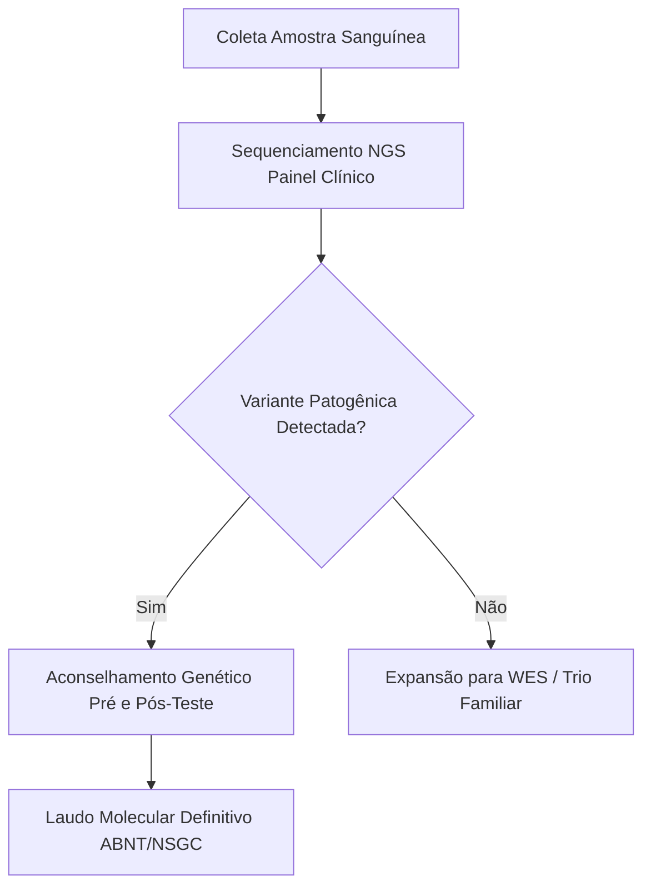

# Investigação Genômica de Variante Familiar Rara

## Resumo
Apresentamos a investigação de segregação fenotípica de variante candidata
em uma linhagem familiar com três gerações documentadas.

## Heredograma Clínico Familiar
```heredograma
%% layout.width=90% layout.max_width=550pt cex=0.85
id,pai,mae,sex,fenotipo,label
1,0,0,M,wt,Avô
2,0,0,F,wt,Avó
3,1,2,M,het,Pai
4,0,0,F,wt,Mãe
5,3,4,F,hom,Probanda
6,3,4,M,wt,Irmão
```

## Fluxo Laboratorial e Conduta


## Conclusão
A identificação precoce através do pipeline reprodutível permitiu direcionamento
terapêutico preciso conforme as diretrizes do CFM e NSGC.
