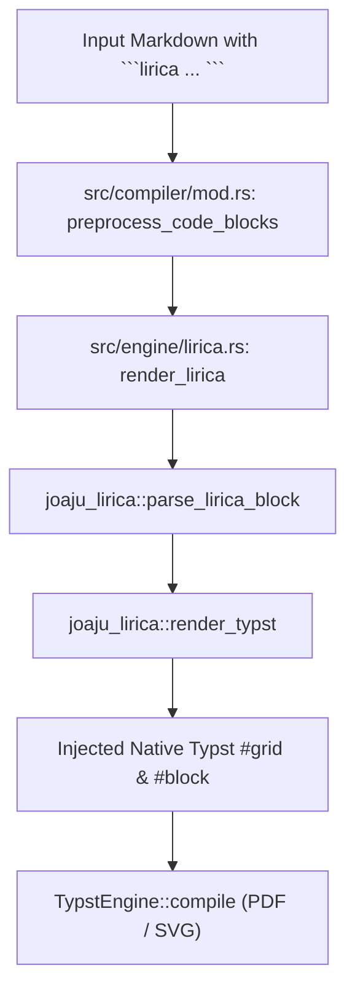

# Technical Specification: joaju-lirica Integration in the Joaju Academic Compiler

- **Ticket:** #45
- **Branch:** `feat/45-integrate-joaju-lirica`
- **Standard:** GOST DD-TDD v1.5.0
- **Status:** In Progress (Phase 3: Spec)

---

## 1. Overview & Scope

This specification defines the integration of the poetic scansion engine **`joaju-lirica`** into the core **`joaju`** academic compiler.

The compiler will recognize fenced code blocks marked with `lirica` in markdown documents, parse optional `%%` configuration directives, and seamlessly transpile them into native Typst typography with metric syllable counts, rhythm classifications, and stress indicators.

---

## 2. Architecture & Pipeline



---

## 3. Implementation Details

### 3.1 Dependency Declaration (`Cargo.toml`)
- Add `joaju-lirica = { version = "0.1.0", registry = "lumen" }` to `[dependencies]`.
- Add local path override under `[patch."sparse+https://git.2lp.in/api/packages/lumen/cargo/"]`:
  `joaju-lirica = { path = "../joaju-lirica" }`.

### 3.2 Engine Adapter (`src/engine/lirica.rs`)
- Expose `pub fn render_lirica(code: &str) -> Result<String, String>`.
- Calls `joaju_lirica::parse_lirica_block(code)` and converts the parsed poem into native Typst markup via `joaju_lirica::render_typst`.
- Propagates errors cleanly if parsing fails.

### 3.3 Engine Module Registration (`src/engine/mod.rs`)
- Add `pub mod lirica;`.

### 3.4 Compiler Integration (`src/compiler/mod.rs`)
- Regex pattern matching: `r"(?s)```lirica\s*\n(.*?)```"`.
- Replace matched blocks with the rendered Typst markup wrapped in protective line breaks.

---

## 4. Test Suite (TDD Acceptance Criteria)

1. **Unit Test (`src/engine/lirica.rs`)**:
   - Verify `render_lirica` transforms a sample verse into Typst grid code containing the poem lines and metric count.
2. **Compiler Preprocessing Test (`tests/test_lirica.rs`)**:
   - Verify `preprocess_code_blocks` replaces ````lirica with Typst output without producing external SVG assets.
3. **End-to-End Document Compilation**:
   - Verify `compile_markdown_to_pdf` compiles a document containing a ````lirica block without panics or Typst syntax errors.
