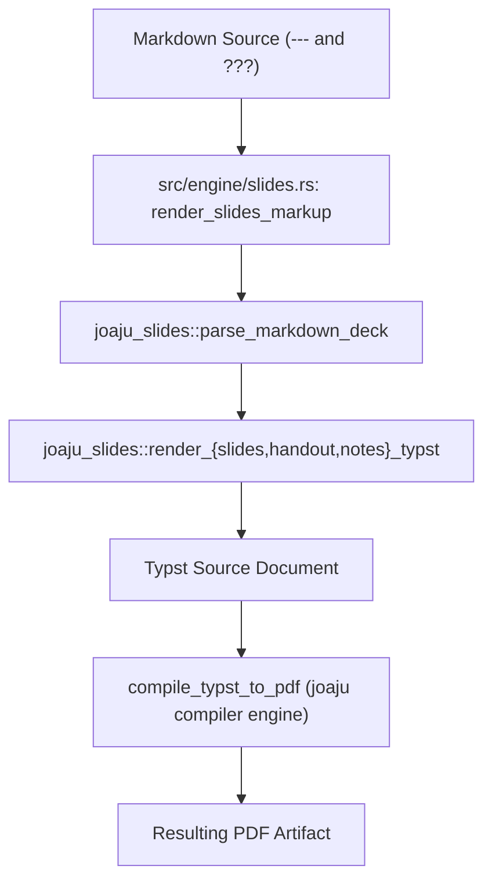

# Technical Specification: joaju-slides Integration in the Joaju Academic Compiler

- **Ticket:** #46
- **Branch:** `feat/46-integrate-joaju-slides`
- **Standard:** GOST DD-TDD v1.5.0
- **Status:** In Progress (Phase 3: Spec)

---

## 1. Overview & Scope

This specification defines the integration of the presentation slides, handouts, and speaker notes engine **`joaju-slides`** into the core **`joaju`** academic compiler and CLI.

The compiler will support rendering unified Markdown documents containing slide delimiters (`---`) and speaker notes delimiters (`???`) directly into Typst markup or compiled PDF across three modes:
1. **Slides Mode (`--slides`):** 16:9 or 4:3 widescreen presentation slides.
2. **Handout Mode (`--handout`):** A4 sheets featuring slide thumbnails in the top third and detailed notes below.
3. **Notes Mode (`--notes`):** Continuous textual notes document converting slide titles into formal section headers.

---

## 2. Architecture & Pipeline

---

## 3. Implementation Details

### 3.1 Dependency Declaration (`Cargo.toml`)
- Add `joaju-slides = { version = "0.1.0", registry = "lumen" }` to `[dependencies]`.
- Add local path override under `[patch."sparse+https://git.2lp.in/api/packages/lumen/cargo/"]`:
  `joaju-slides = { path = "../joaju-slides" }`.

### 3.2 Engine Adapter (`src/engine/slides.rs`)
- Expose `render_slides_markup(markdown: &str, mode: PresentationMode) -> Result<String, String>`.
- Expose `compile_slides_to_pdf(markdown: &str, mode: PresentationMode) -> Result<Vec<u8>, String>`.
- Re-export `PresentationMode`, `SlideAspectRatio`, `SlideDeck`, `SlideBlock` for consumers.

### 3.3 Engine Module Registration (`src/engine/mod.rs`)
- Add `pub mod slides;`.

### 3.4 CLI Commands (`src/main.rs`)
- Add `Slides` subcommand or flags to `Compile` (`--slides`, `--handout`, `--notes`).

### 3.5 GitOps Cascade Workflow (`.forgejo/workflows/ci.yaml`)
- Update satellite dependencies in workflow dispatch:
  `cargo update -p joaju-csv -p joaju-table -p joaju-pedigree -p joaju-unfurl -p joaju-lirica -p joaju-slides || cargo update`.

---

## 4. Test Suite (TDD Acceptance Criteria)

1. **Unit Test (`src/engine/slides.rs`)**:
   - Verify `render_slides_markup` produces valid Typst code for Slides, Handout, and Notes modes.
2. **Compiler End-to-End Test (`tests/test_slides.rs`)**:
   - Verify `compile_slides_to_pdf` compiles sample slide markdown into valid PDF byte buffers (`%PDF-`).
3. **CLI Invocation Test**:
   - Verify CLI dispatches slide rendering without errors.
