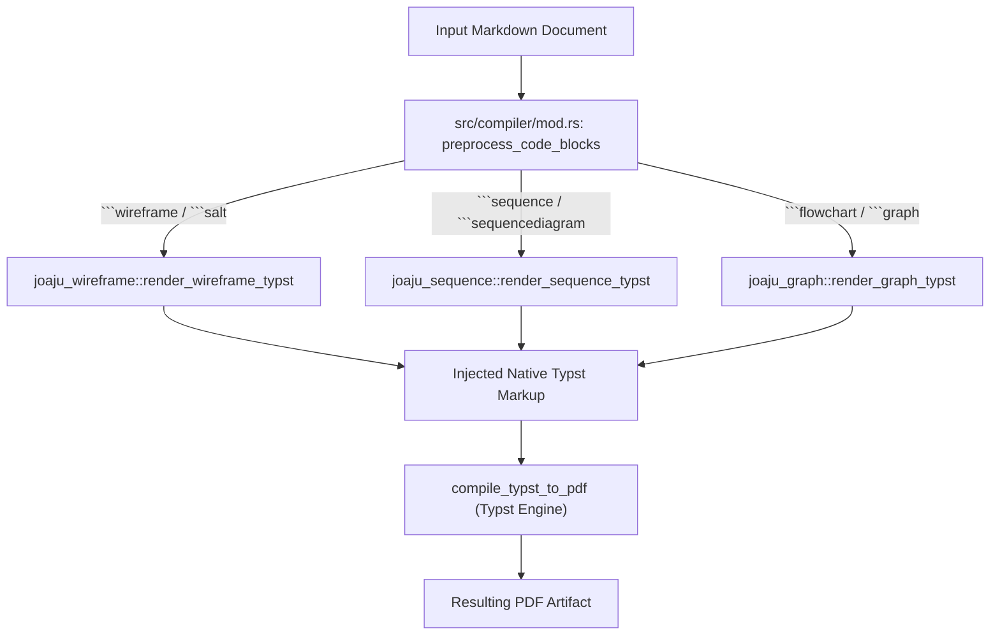

# Technical Specification: Native Diagram Engines Integration (joaju-wireframe, joaju-sequence, joaju-graph)

- **Ticket:** #58 (integrates #59, #60, #61)
- **Branch:** `feat/58-integrate-native-diagram-engines`
- **Standard:** GOST DD-TDD v1.5.0
- **Status:** Phase 8: Quality Gate (Approved)

---

## 1. Overview & Scope

This specification defines the integration of the three sovereign, pure-Rust satellite diagram engines into the core **`joaju`** academic compiler:
1. **`joaju-wireframe`**: UI mockups, forms, and modernized Salt widgets.
2. **`joaju-sequence`**: Deterministic temporal sequence diagrams.
3. **`joaju-graph`**: Flowcharts, connected graphs, UML, and cloud architecture.

All three engines are consumed as standalone packages published to the sovereign `gambi` registry (`registry = "gambi"`), maintaining the zero-local-path hermeticity standard of the Joaju compiler.

---

## 2. Architecture & Pipeline



---

## 3. Dependency Declaration (`Cargo.toml`)

```toml
joaju-wireframe = { version = "0.1.0", registry = "gambi" }
joaju-sequence = { version = "0.1.0", registry = "gambi" }
joaju-graph = { version = "0.1.0", registry = "gambi" }
```

---

## 4. Preprocessor Rules (`src/compiler/mod.rs`)

1. **Wireframes / Salt:**
   - Pattern: `r"(?s)```(wireframe|salt)\s*\n(.*?)```"`
   - Output: `joaju_wireframe::render_wireframe_typst(code)`
2. **Sequence Diagrams:**
   - Pattern: `r"(?s)```(sequence|sequencediagram)\s*\n(.*?)```"`
   - Output: `joaju_sequence::render_sequence_typst(code)`
3. **Connected Graphs & Flowcharts:**
   - Pattern: `r"(?s)```(flowchart|graph)\s*\n(.*?)```"`
   - Output: `joaju_graph::render_graph_typst(code)`

---

## 5. Test Suite & Acceptance Criteria (GOST DD-TDD)

1. **Preprocessor Unit Tests (`tests/test_diagrams_integration.rs`):**
   - Verify `preprocess_code_blocks` handles ````wireframe, ````sequence, and ````flowchart without generating binary raster/image assets.
2. **End-to-End Document Compilation:**
   - Verify a single academic Markdown document combining wireframes, sequence diagrams, and flowcharts compiles into a valid `%PDF-` document.
3. **Registry Hermeticity Audit:**
   - `tests/audit_registry_dependencies.sh` passes with 0 local path violations.
