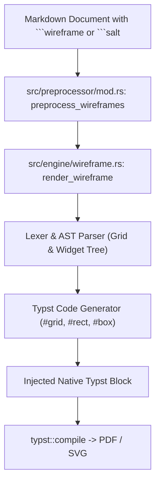

# Technical Specification: Native UI Wireframes & Mockups Engine (joaju-wireframe)

- **Ticket:** #59
- **Branch:** `59-feat-diagram-motor-nativo-de-mockups-de-interface-ui-wireframes`
- **Standard:** GOST DD-TDD v1.5.0
- **Status:** Phase 3: Spec (Review & Discussion)

---

## 1. Overview & Scope

This specification defines the native UI wireframing and mockup engine for the **Joaju** academic compiler.

Historically, Joaju relied on PlantUML (Salt) via an external Kroki HTTP gateway running a Java Virtual Machine to render user interface wireframes. This implementation replaces that external dependency with a **100% pure Rust** parser and renderer that compiles declarative UI descriptions directly into native Typst layout primitives (`#grid`, `#rect`, `#stroke`, `#fill`, `#box`).

The compiler will recognize fenced code blocks marked with `wireframe` or `salt`, parse layout directives (`%%`), and seamlessly generate clean, publication-grade wireframes sharing the exact typography of the host document.

---

## 2. Architecture & Pipeline



---

## 3. Declarative UI Syntax (Salt + Modern Extensions)

### 3.1 Containers & Grids
- **Window / Frame:**
  - Enclosed in `{+ ... }` or `wireframe { ... }` with optional title header (`{+ "Janela Principal" | ... }`).
- **Layout Matrix (Grid):**
  - Columns separated by `|`.
  - Line breaks indicate new rows.
  - Horizontal separator: `--` (subtle divider line).

### 3.2 Standard Widgets (Salt Compatibility)
- **Buttons:** `[ Botão ]` or `[OK]`
- **Text Inputs:** `"Texto prévio   "` or `"Digite aqui..."`
- **Checkboxes:** `[ ] Desmarcado` or `[X] Marcado`
- **Radio Buttons:** `( ) Não selecionado` or `(X) Selecionado`
- **Droplist / Combobox:** `^Selecione uma opção^`
- **Tabs (Abas):** `{/ Geral | Segurança | Notificações }`
- **Plain Text / Labels:** Raw text without delimiters (e.g. `Nome do Usuário:`)

### 3.3 Modern Joaju Extensions
- **Badges / Tags:** `<Ativo>`, `<Tag: Sucesso>`
- **Switches / Toggles:** `(O)` (ligado/ativo), `(!)` (desligado)
- **Progress Bars:** `[====.... 50%]`
- **Avatares / Ícones:** `(@)` ou `(@usuária)`

---

## 4. Typst Design & Aesthetic Guidelines

Unlike legacy PlantUML Salt (which generates 1990s-era pixelated bitmaps or rigid grey Windows 95 widgets), the Joaju native engine adopts a **contemporary, clean editorial wireframe aesthetic**:
- **Geometry:** Subtle corner rounding (`radius: 3pt` to `4pt`), clean geometric padding.
- **Color Palette:** Soft grayscale neutral theme (`luma(245)` for widget fills, `stroke: 0.75pt + luma(140)`).
- **Interactive State Cues:** Highlighted accents for active tabs, filled checkboxes `[X]`, and toggles.
- **Typography:** Directly inherits document fonts (Linux Libertine, Fira Sans, or document body font), preserving vector text crispness in compiled PDF artifacts.

---

## 5. Implementation Plan

### 5.1 Engine Module (`src/engine/wireframe.rs`)
- Expose `pub fn render_wireframe(source: &str) -> Result<String, String>`.
- Internal data structures:
  ```rust
  pub enum Widget {
      Text(String),
      Button(String),
      TextInput(String),
      Checkbox { label: String, checked: bool },
      Radio { label: String, selected: bool },
      Droplist(String),
      Tabs(Vec<String>, usize),
      Badge(String),
      Toggle(bool),
      Progress(u8),
      Separator,
  }

  pub struct WireframeGrid {
      pub rows: Vec<Vec<Widget>>,
  }
  ```

### 5.2 Preprocessor Integration (`src/preprocessor/mod.rs` & `src/compiler/mod.rs`)
- Match blocks: `r"(?s)```(?:wireframe|salt)\s*\n(.*?)```"`.
- Transpile into native Typst code block.

### 5.3 Public API Registration (`src/lib.rs` & `src/engine/mod.rs`)
- Export `render_wireframe` and re-export relevant structs.

---

## 6. Test Suite (TDD Acceptance Criteria)

1. **Unit Tests (`src/engine/wireframe.rs`):**
   - Parse single widgets: buttons, inputs, checkboxes, radios, droplists, tabs.
   - Parse grid alignments with multiple columns (`|`) and rows.
   - Validate generated Typst string contains valid `#grid`, `#rect`, and escaped label contents.
2. **Preprocessor Integration Tests (`tests/test_wireframe.rs`):**
   - Verify `preprocess_wireframes` replaces ````wireframe and ````salt blocks with pure Typst `#block`.
3. **End-to-End PDF Compilation Test:**
   - Verify full document containing ````wireframe compiles to `%PDF-` without errors.
